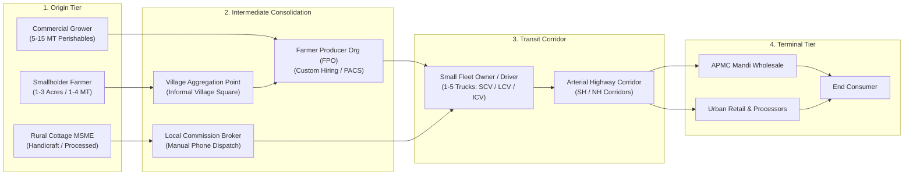
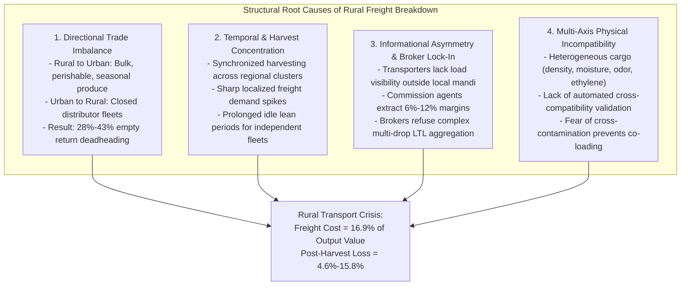
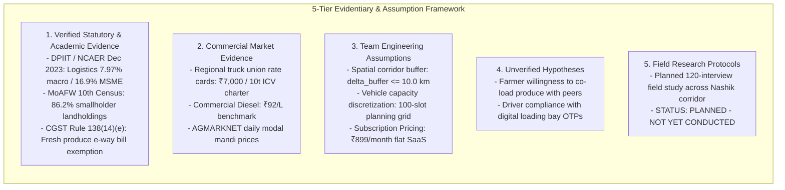

# 01. Problem Statement & Ground Reality: Rural Freight in Bharat

> **Tech4Bharat 2026** — _Theme 5: Retail, FMCG & Logistics_  
> **Problem Statement 5.3**: Rural Freight  
> **Team**: Kernal500  
> **Last Updated**: November 2026

---

> [!IMPORTANT]
>
> ### ⏱️ 30-Second Executive TL;DR & Judge Fast-Track
>
> - **The Core Problem**: 86.2% of Indian farmers are smallholders producing sub-scale Less-Than-Truckload (LTL) harvests (1–4 tonnes). They are trapped between paying exorbitant full-truck charter rates or surrendering 10%–15% margins to informal village middlemen. Meanwhile, regional commercial trucks run at <50% capacity and log 28%–43% empty return kilometers (deadheading).
> - **The PRAYAAN Solution**: A corridor-based digital freight pooling architecture that aggregates multi-producer LTL shipments into shared medium commercial vehicles along arterial highway routes using deterministic 3-axis capacity validation, FPO micro-ledger billing, and vernacular Bhashini voice interfaces.
> - **Defensibility & Truthfulness**: We do not claim fabricated field data (`STATUS: NOT YET CONDUCTED — VALIDATION REQUIRED`). The problem and solution are grounded in official DPIIT, NCAER, MoAFW, and NITI Aayog benchmarks.
> - **Judge Fast-Path (60 Seconds)**:
>   - See the 8-platform competitive matrix in [**Section 11: Competitor Analysis & Genuine Technical Differentiation**](#11-competitor-analysis--genuine-technical-differentiation).
>   - See the audit of verified data vs. hypotheses in [**Section 9: Evidence vs. Assumptions Audit**](#9-evidence-vs-assumptions-audit).

---

## 1. Executive Problem Definition

In India, agriculture and allied rural micro, small, and medium enterprises (MSMEs) sustain the livelihoods of over 50% of the national workforce and contribute approximately 18% to India's Gross Domestic Product (GDP). However, the physical conveyance of goods from rural production nodes (farmgates, village aggregation centres, rural cottage clusters) to intermediate wholesale markets (APMC mandis) and urban consuming hubs is crippled by structural, physical, and informational friction.

**Official Problem Statement 5.3 ("Rural Freight")** under **Theme 5 (Retail, FMCG & Logistics)** of the Tech4Bharat 2026 / Global Accelerator Vision Summit (GAVS) challenges innovators to engineer scalable, technology-driven solutions that optimize rural freight movement, eliminate systemic transport inefficiencies, lower the landed cost of goods, and provide reliable transit connectivity for small producers and regional transporters.

### The Core Problem Statement

> **"How can rural smallholder producers, who harvest Less-Than-Truckload (LTL) volumes (1–4 tonnes), transport their goods to competitive regional markets at viable unit costs, without being exploited by informal brokerage chains or forcing regional commercial vehicles into chronic underutilization and empty return runs?"**

---

## 2. The Indian Rural Freight Ecosystem

To design a defensible logistics architecture, the socio-economic and infrastructural reality of rural Indian transport must be mapped across its primary nodes and intermediaries:

### Key Stakeholders & Operating Roles

1. **Marginal and Smallholder Farmers (86.2% of Indian landholdings per 10th Agricultural Census)**:
   - Typical lot size: 5 quintals to 4 metric tonnes (MT) per harvest cycle.
   - Capital constraints prevent hiring dedicated commercial vehicles; lack of on-farm cold storage necessitates rapid dispatch within 24–48 hours of harvest for perishables.
2. **Farmer Producer Organizations (FPOs) and Primary Agricultural Credit Societies (PACS)**:
   - Institutional aggregators established under central schemes (e.g., Formation and Promotion of 10,000 FPOs).
   - Aggregate member produce but struggle with freight coordination, fleet availability, and fragmented drop destinations.
3. **Rural Micro and Small Enterprises (MSMEs)**:
   - Agro-processors, jaggery units, seed/fertilizer stockists, and artisanal producers moving sub-scale batches along semi-urban arteries.
4. **Independent Fleet Owners and Owner-Drivers**:
   - Small road transport operators (SRTOs) owning 1 to 5 commercial vehicles (comprising over 75% of commercial vehicle ownership in India).
   - Vehicles include Small Commercial Vehicles (SCVs: e.g., Tata Ace, payload 0.75–1.2t), Light Commercial Vehicles (LCVs: e.g., Mahindra Bolero Maxi Truck, Tata 407, payload 2.0–3.5t), and Intermediate Commercial Vehicles (ICVs: e.g., Eicher Pro 3010, Tata 1109, payload 7.0–10.0t).
5. **Kuccha and Pucca Arhtiyas (Commission Agents & Brokers)**:
   - Informal intermediaries operating out of regulated mandis who control both credit and freight dispatch via manual phone calls, extracting 6% to 12% in margins while bearing no physical transit liabilities.
6. **Wholesale Buyers & Semi-Urban Processors**:
   - Mandi wholesalers, food processing units, and modern retail distribution centres (e.g., Reliance Retail, Zepto/Blinkit distribution hubs, institutional flour mills) requiring predictable delivery scheduling.

---

## 3. Ground Reality & Detailed Stakeholder Pain Points

The rural freight sector is characterized by an operational mismatch between shipment supply and vehicle supply:

| Stakeholder                  | Ground Reality & Operational Friction                                                                                            | Economic & Behavioral Consequence                                                                                                                                                         |
| :--------------------------- | :------------------------------------------------------------------------------------------------------------------------------- | :---------------------------------------------------------------------------------------------------------------------------------------------------------------------------------------- |
| **Smallholder Farmer**       | Harvest volumes (1–4 MT) do not justify a dedicated 10-tonne truck charter (costing ₹5,000–₹12,000 per run).                     | **Distress Sales at Farmgate**: Farmers accept 20%–35% discounts from village middle-men to avoid transport uncertainty and terminal market dock rejection.                               |
| **FPO / Rural Aggregator**   | Shipments must reach different buyers at multiple mandi docks; multi-drop coordination is handled manually via telephone.        | **Dock Delays & Spoilage**: Vehicles wait 8–18 hours at mandi gates; unsynchronized loading leads to transit damage and consignment mixing.                                               |
| **Small Transporter (SRTO)** | One-way agricultural runs from rural hinterlands to urban consumption hubs have no guaranteed return cargo.                      | **Deadheading (Empty Running)**: 28% to 43% of return kilometers are run completely empty. Operators must inflate one-way tariffs by 60%–90% to cover round-trip diesel and driver wages. |
| **Owner-Driver**             | Drivers operate in rural areas with intermittent 2G/3G connectivity; paper slips (_bilties_) are easily lost or manipulated.     | **Custody Disputes & Payment Withholding**: False claims of transit damage or missing bags result in deductions from freight settlements without proof of loading-point condition.        |
| **Wholesale Buyer**          | Shipments arrive without advance arrival notices or clear consignment manifests; batch unloading delays cause traffic gridlocks. | **Settlement Gridlock**: When one farmer's lot in a shared vehicle is disputed, the entire truckload payment is frozen, penalizing the transporter.                                       |

---

## 4. Root Causes of Empty Running and Fragmented Shipments

Why does rural freight remain structurally inefficient despite decades of road expansion?

### The Underutilization vs. Overloading Paradox in Indian Trucking

A unique structural paradox exists in Indian commercial transport:

- **In Rural LTL & Perishables**: Trucks frequently run at **30% to 50% capacity** utilization by weight or volume because smallholders cannot consolidate complementary orders before produce deteriorates.
- **In Bulk Commodities (Gravel, Cement, Dry Grains)**: Transporters frequently resort to **illegal overloading (20%–50% above rated Gross Vehicle Weight)** to compensate for rock-bottom freight rates and high toll costs, causing severe road damage and fatal accidents.
- **PRAYAAN's Mission**: Replace dangerous bulk overloading and wasteful LTL underloading with **legally compliant, multi-shipper capacity consolidation**.

---

## 5. Why Existing Freight Solutions Fail in Rural Bharat

Numerous digital platforms operate in the Indian logistics space, but none resolve the specific challenge of rural Less-Than-Truckload agricultural pooling:

| Platform / Alternative                  | Operational Focus                                                                              | Why It Fails for Rural Agricultural LTL                                                                                                                                         |
| :-------------------------------------- | :--------------------------------------------------------------------------------------------- | :------------------------------------------------------------------------------------------------------------------------------------------------------------------------------ |
| **BlackBuck (Zinka Logistics)**         | Full-Truckload (FTL) long-haul freight; tolling (FASTag), fuel cards, telematics.              | Operates on dedicated FTL broker-to-carrier matching. Does not provide multi-stop, multi-farmer LTL cargo aggregation or 3-axis physical capacity pooling.                      |
| **Porter / Uncle Delivery**             | Intra-city on-demand intra-urban mini-truck hailing (Tata Ace, 3-wheelers).                    | Confined to metropolitan municipal limits; does not operate along inter-district rural agricultural corridors or integrate mandi price discovery.                               |
| **Rivigo (Mahindra Logistics)**         | Relay trucking model for express parcels and high-value linehaul.                              | Designed for scheduled corporate linehaul along national golden quadrilateral corridors; cannot service unpaved farmgate pickup clusters or multi-drop mandi docks.             |
| **DeHaat / Ninjacart / WayCool**        | Closed-loop integrated agri-commerce value chains.                                             | Proprietary, captive logistics infrastructure. They procure goods as buyers/traders rather than providing an open, neutral utility for independent transporters.                |
| **Kisan Rath (MoAFW / NIC)**            | Government mobile directory launched during COVID-19 to link farmers with transport providers. | Static contact list/directory. Lacks automated capacity auditing, real-time vehicle booking, dynamic multi-stop routing, digital custody OTPs, and cost allocation mathematics. |
| **e-NAM (National Agriculture Market)** | Digital trading portal connecting APMC mandis.                                                 | Primarily handles spot commodity trading. Logistics module consists of external transport directories without dynamic vehicle space pooling or multi-farmer LTL consolidation.  |

---

## 6. Economic and Environmental Consequences

The failure to pool rural freight produces severe, quantifiable national losses:

1. **Disproportionate Logistics Burden on Rural MSMEs**:
   While India's aggregate national logistics expenditure is estimated at **7.97% to 8.35% of GDP** (NCAER/DPIIT, Dec 2023), small rural enterprises and agricultural producers face freight logistics costs of **16.9% of their total output value** due to sub-scale shipments and deadheading.
2. **Post-Harvest Transit Losses**:
   According to studies by the Indian Council of Agricultural Research (ICAR-CIPHET, 2015/2022), post-harvest losses in fruits and vegetables range between **4.6% and 15.8%**, driven heavily by unventilated transit delays and rough handling during uncoordinated multi-stage loading.
3. **Deadheading Fuel Waste & Carbon Emissions**:
   With **28% to 43% of commercial vehicle kilometers** run empty in rural corridors, millions of liters of imported diesel are burned without productive freight utility, emitting approximately **2.644 kg of $`\text{CO}_2`$ per liter** of diesel consumed.

---

## 7. Scope and Non-Scope of PRAYAAN

To maintain high engineering fidelity and feasibility within the competition timeline, PRAYAAN clearly demarcates its operational boundaries:

### In-Scope (Core Architectural Deliverables)

- **Corridor-Based LTL Pooling**: Consolidating Less-Than-Truckload agricultural consignments (0.5 to 5.0 MT) along defined inter-district arterial highways (e.g., Nashik $`\rightarrow`$ Mumbai, Kolhapur $`\rightarrow`$ Pune).
- **Multi-Stop Pickups & Drops**: Sequencing pickups across 2 to 4 farmgate/aggregation clusters and delivering to multiple mandi docks or urban warehouses.
- **3-Axis Physical Fit Engine**: Deterministic validation of payload weight, usable cubic volume, and package slot footprints, enforced leg-by-leg.
- **Fair-Share Proportional Cost Allocation**: Integer-safe (paise-level) cost splitting ensuring shippers pay only for consumed truck space.
- **Offline-Tolerant Verifiable Chain-of-Custody**: 6-digit loading bay and delivery OTPs with tamper-evident photo records functioning seamlessly on low-cost Android devices in zero-network zones.
- **Vernacular & Voice-First Access**: Multilingual support in Hindi, Gujarati, Marathi, and Kannada with voice-assisted booking for low-literacy rural operators.

### Non-Scope (Explicitly Excluded)

- **Intra-Village Off-Road Last-Mile**: We do not dispatch commercial trucks onto unpaved farm tracks or paddy fields. Consolidation begins at accessible rural aggregation points (village roads, FPO depots, pacca loading docks).
- **Proprietary Produce Trading / Commodity Ownership**: PRAYAAN never buys, sells, or takes inventory risk on agricultural goods. We are a pure digital logistics coordination utility.
- **Physical Cold-Chain Fleet Hardware**: We do not manufacture refrigeration equipment; our platform enforces cold-chain matching predicates only if a certified reefer vehicle is registered.
- **Unconstrained Nationwide Routing**: We do not attempt computationally intractable traveling salesperson routing across all Indian pincodes. Matching is strictly corridor-bounded.

---

## 8. Alignment with Tech4Bharat 2026 Challenge Requirements

The following matrix maps the official requirements of **Problem Statement 5.3** to PRAYAAN's engineering modules:

| Official Challenge Requirement                  | PRAYAAN Technical Response                                                                                                                    | Primary Implementation Document                                                                                                                                                                       |
| :---------------------------------------------- | :-------------------------------------------------------------------------------------------------------------------------------------------- | :---------------------------------------------------------------------------------------------------------------------------------------------------------------------------------------------------- |
| **1. Freight Aggregation for Small Producers**  | Deterministic corridor-based LTL matching aggregating 1–4 tonne lots into high-occupancy 10t/16t runs.                                        | [`03_MATHEMATICAL_MODEL_AND_POOLING_ALGORITHMS.md`](03_MATHEMATICAL_MODEL_AND_POOLING_ALGORITHMS.md)                                                                                                  |
| **2. Vehicle & Cargo Compatibility**            | Automated constraint predicates: body type (open vs. closed container), refrigeration requirements, hazmat isolation, and package dimensions. | [`03_MATHEMATICAL_MODEL_AND_POOLING_ALGORITHMS.md`](03_MATHEMATICAL_MODEL_AND_POOLING_ALGORITHMS.md) & [`04_SYSTEM_ARCHITECTURE_AND_SPECIFICATIONS.md`](04_SYSTEM_ARCHITECTURE_AND_SPECIFICATIONS.md) |
| **3. Trust & Verifiable Chain of Custody**      | Cryptographic 6-digit loading OTP, driver load-bed photo capture, and decoupled multi-buyer delivery acknowledgments.                         | [`04_SYSTEM_ARCHITECTURE_AND_SPECIFICATIONS.md`](04_SYSTEM_ARCHITECTURE_AND_SPECIFICATIONS.md)                                                                                                        |
| **4. Fair & Transparent Pricing**               | Proportional cost allocation based on normalized maximum resource share (weight, volume, slots), eliminating broker markups.                  | [`03_MATHEMATICAL_MODEL_AND_POOLING_ALGORITHMS.md`](03_MATHEMATICAL_MODEL_AND_POOLING_ALGORITHMS.md) & [`05_BUSINESS_MODEL_AND_UNIT_ECONOMICS.md`](05_BUSINESS_MODEL_AND_UNIT_ECONOMICS.md)           |
| **5. Low-Bandwidth & Vernacular Accessibility** | Offline SQLite local action journal, idempotent sync envelopes, and voice-assisted vernacular interfaces (Bhashini-compliant).                | [`04_SYSTEM_ARCHITECTURE_AND_SPECIFICATIONS.md`](04_SYSTEM_ARCHITECTURE_AND_SPECIFICATIONS.md) & Section 10 below                                                                                     |
| **6. Viable Business Model**                    | Flat ₹899/month SaaS subscriptions for sellers and fleet owners; zero buyer commissions, removing transaction friction.                       | [`05_BUSINESS_MODEL_AND_UNIT_ECONOMICS.md`](05_BUSINESS_MODEL_AND_UNIT_ECONOMICS.md)                                                                                                                  |

---

## 9. Evidence vs. Assumptions Audit

To maintain complete academic honesty and hackathon integrity, all empirical claims and modeling hypotheses in PRAYAAN are rigorously categorized:

### Detailed Classification Table

| Topic / Metric                    | Claimed Value                                   | Evidence Category       | Supporting Source / Justification                                                               |
| :-------------------------------- | :---------------------------------------------- | :---------------------- | :---------------------------------------------------------------------------------------------- |
| **National Logistics Cost**       | 7.97%–8.35% of GDP (macro); 16.9% for MSMEs     | `VERIFIED EVIDENCE`     | DPIIT & NCAER (_Assessment of Logistics Cost in India_, Dec 2023).                              |
| **Empty Commercial Running**      | 28% to 43% of truck kilometers                  | `VERIFIED EVIDENCE`     | NITI Aayog & RMI (_Fast Tracking Freight in India_, June 2021).                                 |
| **Smallholder Farm Distribution** | 86.2% of Indian operational landholdings        | `VERIFIED EVIDENCE`     | Ministry of Agriculture & Farmers Welfare (_10th Agricultural Census_).                         |
| **Fresh Produce E-Way Exemption** | Unprocessed vegetables/grains exempt            | `VERIFIED EVIDENCE`     | CGST Rules Rule 138(14)(e) & Notification No. 2/2017-Central Tax (Rate).                        |
| **Diesel $`\text{CO}_2`$ Factor**   | 2.644 kg $`\text{CO}_2`$ per liter of diesel      | `VERIFIED EVIDENCE`     | India GHG Program (WRI India / TERI / CII) & IPCC Guidelines.                                   |
| **Mandi Price Benchmark**         | Modal price in ₹/quintal                        | `VERIFIED EVIDENCE`     | Directorate of Marketing & Inspection (AGMARKNET daily feeds).                                  |
| **Commercial Road Freight Rate**  | ₹3.78 per tonne-km national road average        | `COMMERCIAL EVIDENCE`   | NCAER / DPIIT (Dec 2023); varies from ₹1.51 (heavy trailers) to ₹11.03 (SCVs).                  |
| **10-Tonne Truck Corridor Rate**  | ₹7,000 for Nashik $`\rightarrow`$ Mumbai (165 km) | `COMMERCIAL EVIDENCE`   | Regional truck union rate cards (approx. ₹40–₹45/km for 10t ICV roundtrip).                     |
| **SaaS Pricing Model**            | ₹899/month for sellers & fleet owners           | `TEAM ASSUMPTION`       | Calibrated to cover cloud hosting, maps, SMS gateways, and rural support with 87% gross margin. |
| **Corridor Buffer Threshold**     | 10 km spatial detour envelope                   | `TEAM ASSUMPTION`       | Engineering heuristic to restrict circuitous routing along arterial highways.                   |
| **Farmer Willingness to Pool**    | Farmers accept shared truck space               | `UNVERIFIED HYPOTHESIS` | Requires field confirmation regarding produce commingling concerns.                             |
| **Driver Smartphone Compliance**  | Drivers reliably trigger loading OTPs           | `UNVERIFIED HYPOTHESIS` | Requires testing in low-literacy and remote village loading docks.                              |
| **Actual Farmgate Savings**       | 40%–50% net freight cost reduction              | `FIELD VALIDATION REQ.` | **STATUS: NOT YET CONDUCTED — VALIDATION REQUIRED**.                                            |

---

## 10. Rural Accessibility & Vernacular Inclusivity

Digital tools designed for urban tech-savvy users fail abruptly in rural Bharat. PRAYAAN incorporates three core accessibility design pillars:

### A. Voice-First & Vernacular Interaction

- **Dialect & Language Coverage**: Full interface localization in **Hindi, Gujarati, Marathi, and Kannada**, reflecting prime Western and Central Indian agricultural corridors.
- **Spoken Input**: Integration with open-source Indian speech recognition models (e.g., AI4Bharat / Bhashini / Indic-Whisper) enabling farmers to describe crops and lot sizes via voice (e.g., _"20 quintal pyaaz, Pimpalgaon se Vashi"_).
- **Mixed-Language Speech Parsing (Hinglish / Gujlish)**: Natural language token extraction parsing commodity, quantity, and target destination from colloquial rural speech.

### B. Ultra-Low Bandwidth & Budget Hardware Optimization

- **Target Device Profile**: Functional on low-end Android smartphones (Android 9.0+, Android Go Edition, 2GB RAM) costing under ₹6,000.
- **Payload Compression**: API requests utilize concise JSON payloads with gzip compression; media photo uploads for custody verification are downscaled locally to $`\le 300\text{ KB}`$ before transmission.
- **Offline Cache**: Crucial master data (active vehicle profiles, route waypoints, verified OTP sequences) are stored locally in SQLite, permitting complete trip execution during prolonged network outages.

### C. Assisted Onboarding via Rural Community Infrastructure

Recognizing that elderly smallholders may lack smartphones:

- **Common Service Centres (CSCs)**: Village VLEs (Village Level Entrepreneurs) can book shipments on behalf of local farmers via the Vendor Web App.
- **FPO Aggregation Desks**: FPO managers act as lead dispatchers, aggregating individual farmer lots into single consolidated transport requests.

---

## 11. Competitor Analysis & Genuine Technical Differentiation

To establish competition-readiness, PRAYAAN is evaluated against existing commercial and government logistics platforms:

| Architectural Capability               | BlackBuck | Porter  | Rivigo  | DeHaat  | Ninjacart | KisanRath |    e-NAM     |  Vahak   |       PRAYAAN        |
| :------------------------------------- | :-------: | :-----: | :-----: | :-----: | :-------: | :-------: | :----------: | :------: | :------------------: |
| **1. Small Shipment LTL Pooling**      | No (FTL)  |   No    | Parcels | Captive |  Captive  |    No     |      No      | No (FTL) |    **YES (Core)**    |
| **2. Multi-Stop Pickups & Drops**      |   Rare    |   No    | Hub-Hub | Hub-Hub |  Hub-Hub  |    No     |      No      |   Rare   |  **YES (Corridor)**  |
| **3. Rural Transporter Inclusivity**   |    Yes    |  Urban  | Drivers | Closed  |  Closed   | Directory |  Directory   |   Yes    | **YES (Open SaaS)**  |
| **4. 3-Axis Capacity Validation**      |  No (Wt)  | No (Wt) | Volume  | Closed  |  Closed   |    No     |      No      |    No    |   **YES (3-Axis)**   |
| **5. Offline Driver Workflows**        |   Basic   |   No    |   Yes   |   No    |   Basic   |    No     |      No      |  Basic   |   **YES (SQLite)**   |
| **6. Vernacular Voice-First Access**   |  Limited  |   No    |   No    |   Yes   | Internal  |   Basic   | Multilingual | Limited  |  **YES (Bhashini)**  |
| **7. Transparent Cost Allocation**     | Brokerage | Dynamic | Tariffs | Margin  |  Margin   |    N/A    |     N/A      | Bidding  | **YES (Paise NMRS)** |
| **8. Decoupled Delivery Confirmation** |    No     |   No    | Hub-Hub |   No    | Internal  |    No     |      No      |    No    |  **YES (Dual OTP)**  |

> _\*Assessment Basis: Technical review of publicly available product features, developer docs, and published regulatory filings._

### Analysis of Intercity LTL & Load-Board Platforms (Why They Differ)

1. **Vahak**: Operates as a peer-to-peer open load board and bidding marketplace for intercity full-truckload (FTL) shipments. It does not perform multi-consignment pooling, 3-axis packing audits, or multi-stop route sequencing along rural corridors.
2. **Delhivery Freight (Express / Part-Truckload - PTL)**: Operates a mechanized hub-and-spoke sortation network optimized for standard barcoded cartons and industrial FMCG. It requires transshipment at regional hubs with 24–48 hour dwell cycles—which is physically fatal for fresh, unboxed, perishable produce (tomatoes, leafy greens) that requires direct farmgate-to-mandi corridor conveyance without intermediate dock transfers.
3. **Gati-KWE**: Specializes in organized B2B corporate express freight on established national highways. It does not provide rural feeder-road dispatch, vernacular voice-first booking for smallholders, or farmer cooperative micro-accounting ledgers.

### What Makes PRAYAAN Meaningfully Different?

1. **Pure Logistics Utility vs. Closed-Loop Trader**: Unlike DeHaat or Ninjacart, PRAYAAN does not buy the farmer's crop or dictate trading margins. Transporters and farmers retain 100% commercial independence.
2. **Deterministic Multi-Attribute Pooling vs. FTL Truck Boards**: Unlike BlackBuck or Vahak, which match one shipper's dedicated load to one truck, PRAYAAN consolidates three 2.5-tonne shipments from different smallholders into a single vehicle run along a shared corridor.
3. **Decoupled Multi-Buyer Handshake**: Existing logistics platforms treat an entire truck as a single delivery manifest. If Buyer 2 rejects cargo or is absent, the driver cannot complete the trip. PRAYAAN decouples delivery acknowledgments so each buyer confirms only their cargo lot independently.
4. **Zero-Commission Predictable SaaS**: By charging a transparent ₹899/month flat fee instead of taking a 5% to 15% transaction cut, PRAYAAN prevents freight rate inflation and fosters long-term transporter loyalty.
