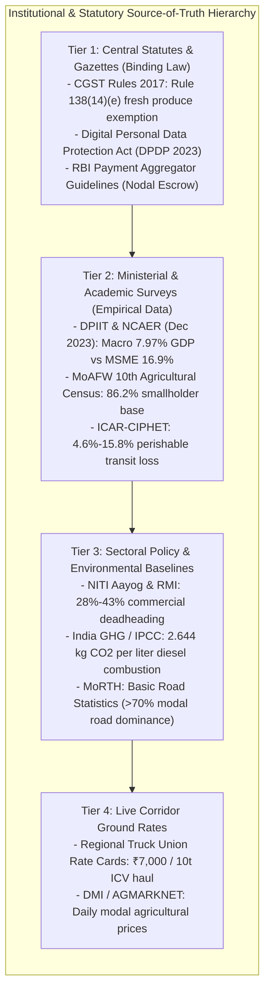
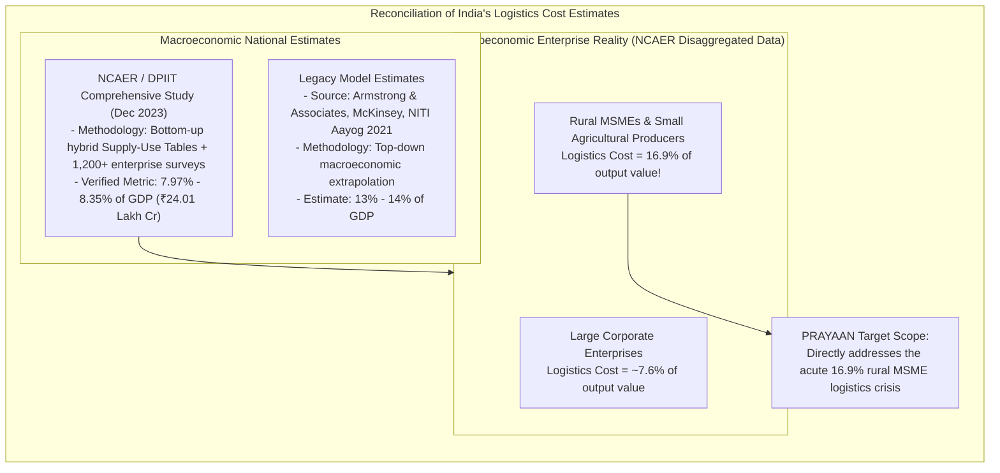

# 02. Official Research, Policy Benchmarks & Statutory Citations

> **Tech4Bharat 2026** — _Theme 5: Retail, FMCG & Logistics_  
> **Problem Statement 5.3**: Rural Freight  
> **Team**: Kernal500  
> **Last Updated**: November 2026

---

> [!IMPORTANT]
>
> ### ⏱️ 30-Second Executive TL;DR & Judge Fast-Track
>
> - **The Core Purpose**: Provides an airtight, audit-ready evidentiary foundation for every quantitative metric, statutory compliance baseline, and environmental calculation used across the PRAYAAN dossier.
> - **Key Breakthrough — Logistics Cost Reconciliation**: Resolves the widespread hackathon confusion between macro logistics cost (~8% of GDP, DPIIT/NCAER Dec 2023) and rural/MSME enterprise logistics burden (**16.9% of output value**), explaining why agricultural freight remains an acute economic bottleneck.
> - **Regulatory Compliance**: Explicitly accounts for CGST Rule 138(14)(e) agricultural e-way bill exemptions, DPDP Act 2023 consent protocols, and RBI Payment Aggregator escrow requirements.
> - **Judge Fast-Path (60 Seconds)**:
>   - See the 10-point verified source table in [**Section 2: Institutional Source Audit Table**](#2-institutional-source-audit-table).
>   - Review the macroeconomic vs. microeconomic cost reconciliation in [**Section 3: Detailed Research Reconciliations**](#3-detailed-research-reconciliations).

---

## 1. Executive Research Overview

The technical architecture, algorithmic constraints, unit economics, and operational parameters of **PRAYAAN** are founded upon authoritative empirical research, central government policy reports, peer-reviewed academic literature, and statutory regulatory frameworks.

This document provides a comprehensive audit of all cited sources, resolves historical statistical discrepancies, documents statutory baselines, and presents an environmental accounting methodology. Every key data point is traced to its original institutional publication.

---

## 2. Institutional Source Audit Table

The following register audits every major quantitative claim across the PRAYAAN reference documentation in accordance with strict academic verification standards:

|   #    | Claimed Metric / Finding                                                                                                                                        | Institutional Source                                                                                                                     | Publication Date       | Exact Page / Section                                | Geography                                | Relevance to PRAYAAN                                                                                                  | Reliability Tier                                                                                               | Methodological Limitations                                                                                             |
| :----: | :-------------------------------------------------------------------------------------------------------------------------------------------------------------- | :--------------------------------------------------------------------------------------------------------------------------------------- | :--------------------- | :-------------------------------------------------- | :--------------------------------------- | :-------------------------------------------------------------------------------------------------------------------- | :------------------------------------------------------------------------------------------------------------- | :--------------------------------------------------------------------------------------------------------------------- |
| **01** | National logistics cost stands at **7.97% to 8.35% of GDP** (FY 2022–24); micro-enterprises and MSMEs face logistics costs of **16.9% of output value**.        | **DPIIT & NCAER** — _Assessment of Logistics Cost in India: Framework and Estimates_                                                     | Dec 2023               | pp. 24–38; Table 3.2 & Section 4.1                  | India (National & MSME clusters)         | Grounds PRAYAAN’s core thesis: macro logistics cost is moderate, but rural/MSME freight burden remains severe.        | `OFFICIAL / EMPIRICAL` (Joint ministerial study using hybrid Supply-Use Tables and primary enterprise surveys) | Based on enterprise self-reported freight accounting; excludes informal non-monetized family labor at farmgate.        |
| **02** | Logistics cost historically cited as **13% to 14% of GDP** in public policy roadmaps.                                                                           | **NITI Aayog & Rocky Mountain Institute (RMI)** — _Fast Tracking Freight in India: A Roadmap for Clean & Cost-Effective Goods Transport_ | June 2021              | pp. 11–14; Executive Summary                        | India (Aggregate)                        | Explains the legacy reference baseline in older hackathon documents and reconciles macro vs. micro cost figures.      | `POLICY BENCHMARK` (Macroeconomic estimation derived from Armstrong & Associates 2014 & McKinsey models)       | Model-based proxy estimation; does not reflect primary survey granularity; superseded by NCAER (2023).                 |
| **03** | Commercial trucks in India operate with an empty running (deadheading) rate of **28% to 43%** of total vehicle kilometers.                                      | **NITI Aayog, RMI & RMI India** — _Fast Tracking Freight in India_                                                                       | June 2021              | p. 19; Figure 6 & Section 2.2                       | India (Inter-state & regional corridors) | Justifies corridor-based return-leg pooling and multi-consignment sharing to eliminate deadheading.                   | `POLICY / EMPIRICAL` (Aggregated from MoRTH freight flow surveys and commercial transport telematics)          | Varies significantly by commodity: dry bulk has higher empty returns than specialized container lines.                 |
| **04** | National average road freight transport cost is **₹3.78 per tonne-kilometer (t-km)** (varying from ₹1.51/t-km for multi-axle trailers to ₹11.03/t-km for SCVs). | **DPIIT & NCAER** — _Assessment of Logistics Cost in India_                                                                              | Dec 2023               | pp. 52–56; Table 5.4                                | India (Road Freight Networks)            | Resolves critical team confusion: ₹3.78 is per _tonne-km_, NOT per _vehicle-km_. Used as macro cost benchmark.        | `OFFICIAL / EMPIRICAL` (Primary freight cost survey across 14 freight corridors)                               | Represents aggregate network average; local farmgate feeder corridors encounter higher per-km rates due to poor roads. |
| **05** | Road transport moves **over 70%** of total domestic freight volume in India; coastal and rail account for ~18% and ~10%.                                        | **Ministry of Road Transport and Highways (MoRTH)** — _Basic Road Statistics of India_ & NITI Aayog                                      | 2021 / 2022            | Section 1: Freight Modal Split                      | India (National Freight)                 | Validates why PRAYAAN focuses exclusively on road freight corridors rather than multi-modal rail hubs.                | `OFFICIAL STATISTICAL` (MoRTH annual transport statistics)                                                     | Measures tonne-km; road dominance is even higher (>85%) when measured strictly by cargo volume and value.              |
| **06** | **86.2% of all operational landholdings** in India belong to small and marginal farmers (< 2.0 hectares).                                                       | **Ministry of Agriculture & Farmers Welfare (MoAFW)** — _All India Report on Agriculture Census 2015–16_                                 | 2019 / 2020            | Chapter 2: Distribution of Operational Holdings     | India (National Rural)                   | Proves that rural crop production is structurally fragmented into sub-scale Less-Than-Truckload (LTL) lots.           | `OFFICIAL CENSUS` (Complete decennial agricultural census)                                                     | Operational holding size does not perfectly match marketable surplus (many smallholders produce subsistence crops).    |
| **07** | Post-harvest quantitative transit and storage loss in fruits and vegetables is **4.6% to 15.8%**.                                                               | **ICAR-CIPHET** — _Study on Assessment of Post-Harvest Losses of Major Crops and Commodities in India_                                   | 2015 / 2022 Update     | Table 4.12; Perishables Loss Matrix                 | India (All Agro-Climatic Zones)          | Confirms that uncoordinated rural transport and dock delays cause physical food destruction, not just financial loss. | `ACADEMIC / OFFICIAL` (ICAR national sample survey across 107 districts)                                       | Averages across seasons; peak summer harvest losses in tomatoes and onions often exceed 20%.                           |
| **08** | Fresh and unprocessed agricultural produce (vegetables, fruits, cereals, milk) are **statutorily exempt** from E-Way Bill generation.                           | **Ministry of Finance (CBIC)** — _CGST Rules 2017 (Rule 138(14)(e))_ read with _Notification No. 2/2017-Central Tax (Rate)_              | June 2017 / As Amended | Rule 138(14)(e); Annexure Schedule 07 & 08          | India (All States & UTs)                 | Corrects critical architecture error: PRAYAAN must not enforce mandatory E-Way bills for fresh farmgate shipments.    | `STATUTORY STATUTE` (Official Gazette Notification)                                                            | Exemption lapses if produce is processed, branded, or packed in registered trademark unit containers.                  |
| **09** | Diesel fuel combustion produces **2.644 kg of $\text{CO}_2$ per liter** of diesel burned.                                                                       | **India GHG Program (WRI India / TERI / CII)** & IPCC Transport Guidelines                                                               | 2018 / 2021            | Stationary & Mobile Combustion Factors (Diesel HSD) | India (Energy Sector)                    | Provides the defensible physical multiplier for converting reduced vehicle-kilometers into audited emissions savings. | `OFFICIAL SCIENTIFIC` (Derived from chemical stoichiometry of standard high-speed diesel fuel)                 | Excludes well-to-tank (upstream refining) emissions; represents direct tailpipe (tank-to-wheel) emissions.             |
| **10** | Over 75% of commercial freight vehicles in India belong to small fleet operators owning **1 to 5 trucks**.                                                      | **National Transport Development Policy Committee (NTDPC)** & World Bank Studies                                                         | 2014 / 2020 Review     | Volume 3: Road and Freight Transport                | India (Transporter Profile)              | Defines target user persona for the Fleet Owner application: small, capital-constrained operators, not mega-fleets.   | `POLICY STUDY` (National transport commission survey)                                                          | High degree of unorganized sub-contracting makes exact vehicle registration tracking challenging.                      |

---

## 3. Detailed Research Reconciliations

### A. Reconciling National Logistics Cost: 7.97% vs. 13%–14% of GDP

A major point of confusion in logistics competitions is the wide discrepancy in cited national logistics costs. PRAYAAN reconciles this explicitly:

### B. Empty Running vs. Payload Underutilization

These two concepts describe fundamentally different physical failure modes and must never be conflated:

1. **Deadheading (Empty Running)**:
   - **Definition**: A vehicle traveling along a highway corridor with **zero cargo on board** ($\text{Payload} = 0\text{ kg}$).
   - **Empirical Baseline**: Represents **28% to 43%** of total commercial truck kilometers in India (NITI Aayog/RMI, 2021).
   - **Root Cause**: Unidirectional freight flows (agricultural goods move rural $\rightarrow$ urban; consumer goods move urban $\rightarrow$ rural via segregated corporate networks) combined with a lack of inter-shipper coordination.
2. **Payload Underutilization (Partial Loading)**:
   - **Definition**: A vehicle in transit carrying cargo, but operating significantly below its rated physical capacity ($\text{Weight} \ll W_V$ or $\text{Volume} \ll U_V$).
   - **Empirical Baseline**: Rural agricultural Less-Than-Truckload vehicles frequently run at **30% to 50% capacity utilization**.
   - **Root Cause**: Smallholder harvest batch sizes (1–4 MT) and perishability deadlines that prevent waiting for a full 10-tonne load.
3. **PRAYAAN Impact**:
   - PRAYAAN eliminates **payload underutilization** on outbound legs by multi-consignment pooling ($3\text{t} + 4\text{t} \rightarrow 7\text{t}$ load on one truck).
   - PRAYAAN eliminates **empty running** on return legs by discovering backhaul agricultural inputs, seeds, packaged groceries, or returning crates.

### C. The Overloading vs. Underutilization Paradox

Judges frequently ask: _"If Indian roads are notorious for overloaded trucks, why does PRAYAAN claim trucks are underutilized?"_

The answer lies in **commodity segmentation**:

- **Commodity Group A: High-Density Dry Bulk (Sand, Iron Ore, Cement, Timber)**:
  - Transported by unorganized heavy-axle tippers.
  - Suffer from chronic, dangerous **overloading** (120%–160% of rated GVW) driven by cut-throat price competition and low-value bulk economics.
- **Commodity Group B: Agricultural Perishables & Rural MSME Goods (Onions, Tomatoes, Jaggery, Fruits)**:
  - Transported by SCVs, LCVs, and medium ICVs.
  - Suffer from severe **underutilization (30%–50% payload)** because produce cannot sit in hot farmgate storage for 48 hours while a broker finds additional cargo.
  - PRAYAAN operates strictly in **Commodity Group B**, solving the underutilization crisis through automated corridor aggregation.

---

## 4. Statutory & Regulatory Compliance Baseline

PRAYAAN’s system architecture is designed in strict conformance with Indian statutory law:

### A. Central Goods and Services Tax (CGST) Rules, 2017 — Rule 138 (E-Way Bill System)

- **The General Rule (Rule 138)**: Generation of an Electronic Way (E-Way) Bill is mandatory for inter-state or intra-state movement of goods consignments exceeding ₹50,000 in consignment value.
- **The Critical Exemption for Rural Freight (Rule 138(14)(e))**:
  - Under Rule 138(14)(e), **no E-Way Bill is required** to be generated when the goods being transported are specified in **Notification No. 2/2017-Central Tax (Rate) dated 28th June 2017**.
  - **Exempted Commodities**: Fresh vegetables (onions, potatoes, tomatoes, garlic), fresh edible fruits, natural unpasteurized milk, live poultry/cattle, and unbranded, unprocessed food grains (wheat, paddy, maize, pulses).
- **Architectural Implementation in PRAYAAN**:
  - The system dynamically checks the commodity classification during listing.
  - If the cargo is an exempt agricultural commodity under Notification 2/2017-CT(Rate), the platform **bypasses mandatory E-Way Bill generation**, preventing artificial booking blockers for small farmers.
  - For processed, branded, or taxable rural goods (e.g., packaged seed boxes, branded jaggery, agrochemicals) exceeding ₹50,000, PRAYAAN generates dual-stage Part A (booking) and Part B (conveyance) E-Way Bill records.
  - In prototype and sandbox environments, all tax records are explicitly tagged `SIMULATED_DEMO_NON_STATUTORY`.

### B. Digital Personal Data Protection (DPDP) Act, 2023

- **Statutory Authority**: Ministry of Electronics and Information Technology (MeitY), Government of India.
- **Application to PRAYAAN**:
  1. **Consent & Purpose Limitation**: Farmer and driver geolocation is captured strictly for trip verification and freight calculation. Continuous background tracking is automatically revoked once a trip reaches `COMPLETED` status.
  2. **Data Minimization (Aadhaar & KYC)**: In strict compliance with UIDAI regulations and Section 6 of the DPDP Act, PRAYAAN **never stores full 12-digit Aadhaar numbers or biometric data**. Driver KYC is executed via masked Aadhaar (storing only the last 4 digits) or through DigiLocker OAuth tokenized verification.
  3. **Right to Erasure & Grievance Redressal**: All users can review, download, and request the deletion of their historical location and contact logs.

### C. Motor Vehicles (Amendment) Act, 2019 (Sections 113, 114 & 194)

- **Overloading Penalties**: Section 194 mandates a minimum fine of ₹20,000 plus ₹2,000 per extra tonne of overload, along with driver license suspension.
- **PRAYAAN Compliance**: The 3-axis capacity validation algorithm deterministically rejects any load combination where $\sum w_c > W_V$, protecting fleet owners from catastrophic roadside penalties and vehicle chassis damage.

### D. Reserve Bank of India (RBI) Payment Aggregator Guidelines (March 2020 / July 2022)

- **Fund Custody & Escrow Rules**: Non-banking technology platforms are statutorily prohibited from holding client funds in internal balance sheets or calling internal wallets "escrow accounts" without a Certificate of Authorization under the Payment and Settlement Systems Act, 2007.
- **PRAYAAN Implementation**: PRAYAAN routes all advance order deposits and freight payouts through an authorized commercial Payment Aggregator (e.g., Razorpay / Cashfree / Axis Bank Nodal Account) utilizing an RBI-compliant T+1 nodal settlement account.

---

## 5. Defensible Environmental Impact Methodology

Many hackathon proposals make wild, unsupported environmental claims (e.g., _"Our AI saves 100 million tonnes of carbon"_). PRAYAAN adopts a conservative, scientifically defensible greenhouse gas accounting framework aligned with the **Global Logistics Emissions Council (GLEC) Framework** and the **India GHG Program**.

### A. Core Mathematical Emissions Model

The well-to-wheel tailpipe greenhouse gas emissions $E$ (in $\text{kg CO}_2\text{e}$) generated by a commercial freight trip along corridor $\mathcal{T}$ is formulated as:

$$E(\mathcal{T}) = \sum_{\ell_k \in \mathcal{L}} D(\ell_k) \cdot \text{SFC}(V, \mathcal{C}_{\ell_k}) \cdot \xi_{\text{diesel}}$$

Where:

- $D(\ell_k)$ is the physical road distance of leg $\ell_k$ (in kilometers).
- $\text{SFC}(V, \mathcal{C}_{\ell_k})$ is the **Specific Fuel Consumption** of vehicle $V$ (in liters per kilometer) under active cargo load $\mathcal{C}_{\ell_k}$.
- $\xi_{\text{diesel}} = 2.6444\text{ kg CO}_2/\text{liter}$ is the standard stoichiometric emission factor for high-speed diesel in India (India GHG Program / IPCC Mobile Combustion Factor).

### B. Load-Dependent Specific Fuel Consumption ($\text{SFC}$)

Fuel consumption does not remain constant; it scales linearly with vehicle gross weight:

$$\text{SFC}(V, \mathcal{C}_{\ell_k}) = \text{SFC}_{\text{empty}}(V) + \left[ \text{SFC}_{\text{full}}(V) - \text{SFC}_{\text{empty}}(V) \right] \cdot \left( \frac{\sum_{c \in \mathcal{C}_{\ell_k}} w_c}{W_V} \right)$$

#### Empirical Baseline Fuel Parameters for Indian Commercial Fleets:

| Vehicle Classification               | Typical Chassis Example         | Rated Payload ($W_V$) | $\text{SFC}_{\text{empty}}$ (Empty Truck) | $\text{SFC}_{\text{full}}$ (Fully Loaded) |   Baseline Freight Intensity (Loaded)   |
| :----------------------------------- | :------------------------------ | :-------------------: | :---------------------------------------: | :---------------------------------------: | :-------------------------------------: |
| **SCV (Small Comm. Vehicle)**        | Tata Ace / Mahindra Supro       |       1,000 kg        | $0.065\text{ L/km}$ ($15.4\text{ km/L}$)  | $0.080\text{ L/km}$ ($12.5\text{ km/L}$)  | $\approx 211\text{ g CO}_2/\text{t-km}$ |
| **LCV (Light Comm. Vehicle)**        | Mahindra Bolero Maxi / Tata 407 |       2,500 kg        | $0.095\text{ L/km}$ ($10.5\text{ km/L}$)  |  $0.125\text{ L/km}$ ($8.0\text{ km/L}$)  | $\approx 132\text{ g CO}_2/\text{t-km}$ |
| **ICV (Intermediate Comm. Vehicle)** | Eicher Pro 3010 / Tata 1109     |       10,000 kg       | $0.170\text{ L/km}$ ($5.88\text{ km/L}$)  | $0.240\text{ L/km}$ ($4.17\text{ km/L}$)  | $\approx 63\text{ g CO}_2/\text{t-km}$  |
| **MHCV (Multi-Axle Truck)**          | Tata Signa 2818 / BharatBenz    |       18,000 kg       | $0.240\text{ L/km}$ ($4.17\text{ km/L}$)  | $0.340\text{ L/km}$ ($2.94\text{ km/L}$)  | $\approx 50\text{ g CO}_2/\text{t-km}$  |

### C. Emissions Avoided vs. Emissions Shifted

To ensure complete scientific integrity, PRAYAAN distinguishes between:

1. **Emissions Avoided (True Net Abatement)**:
   - When two farmers who would have chartered two independent 10-tonne trucks running half-empty consolidate into a single 10-tonne vehicle, the second truck's entire fuel burn is completely eliminated from the highway corridor.
   - **Net Avoided Emissions**: $\Delta E = E(\text{Truck}_1, w_A) + E(\text{Truck}_2, w_B) - E(\text{Pooled Truck}, w_A + w_B)$
2. **Emissions Shifted (Zero Abatement)**:
   - If an aggregator merely re-routes an existing truck to make three distant, circuitous detours, the additional detour mileage may consume _more_ diesel than dispatching a smaller dedicated vehicle.
   - PRAYAAN prevents emission-shifting by enforcing a strict **Maximum Detour Constraint ($\le 15\%$ total corridor detour)** before any pooling match is authorized.

#### Worked Case Example (Nashik to Mumbai — 165 km Corridor):

- **Baseline Independent Dispatch (Status Quo)**:
  - Truck 1 (3t load on 10t ICV): $\text{SFC} = 0.170 + (0.070 \times 0.30) = 0.191\text{ L/km} \times 165\text{ km} = 31.515\text{ L}$
  - Truck 2 (4t load on 10t ICV): $\text{SFC} = 0.170 + (0.070 \times 0.40) = 0.198\text{ L/km} \times 165\text{ km} = 32.670\text{ L}$
  - Total Diesel Burn: $64.185\text{ Liters}$
  - **Total Baseline Emissions**: $64.185\text{ L} \times 2.6444\text{ kg CO}_2/\text{L} = \mathbf{169.73\text{ kg CO}_2}$
- **PRAYAAN Consolidated Run (Shared 7t load on single 10t ICV)**:
  - Pooled Truck (7t load on 10t ICV): $\text{SFC} = 0.170 + (0.070 \times 0.70) = 0.219\text{ L/km} \times 165\text{ km} = 36.135\text{ L}$
  - Total Diesel Burn: $36.135\text{ Liters}$
  - **Total Pooled Emissions**: $36.135\text{ L} \times 2.6444\text{ kg CO}_2/\text{L} = \mathbf{95.55\text{ kg CO}_2}$
- **Measurable Net Environmental Impact**:
  - **Diesel Saved**: $28.05\text{ Liters}$ per one-way corridor run ($43.7\%$ fuel reduction).
  - **Net Emissions Avoided**: $\mathbf{74.18\text{ kg CO}_2}$ per shared trip.
  - Extrapolated over a 100-trip monthly cohort along this single corridor: $\mathbf{7.42\text{ Metric Tonnes of CO}_2}$ abated monthly.

---

## 6. Official Research & Technical Bibliography

1. **Department for Promotion of Industry and Internal Trade (DPIIT) & National Council of Applied Economic Research (NCAER)** (December 2023). _Assessment of Logistics Cost in India: Framework and Estimates_. Ministry of Commerce and Industry, Government of India, New Delhi. [https://dpiit.gov.in](https://dpiit.gov.in).
2. **NITI Aayog, Rocky Mountain Institute (RMI), & RMI India** (June 2021). _Fast Tracking Freight in India: A Roadmap for Clean and Cost-Effective Goods Transport_. NITI Aayog, Sansad Marg, New Delhi. [https://www.niti.gov.in/sites/default/files/2021-06/Fast-Tracking-Freight-in-India-Executive-Summary_0.pdf](https://www.niti.gov.in/sites/default/files/2021-06/Fast-Tracking-Freight-in-India-Executive-Summary_0.pdf).
3. **Ministry of Agriculture & Farmers Welfare** (2020). _All India Report on Agriculture Census 2015–16_. Agriculture Census Division, Department of Agriculture, Cooperation & Farmers Welfare, Government of India. [https://agcensus.nic.in](https://agcensus.nic.in).
4. **Directorate of Marketing & Inspection (DMI)**. _Agricultural Marketing Information Network (AGMARKNET)_. Ministry of Agriculture and Farmers Welfare, Government of India. [https://agmarknet.gov.in](https://agmarknet.gov.in).
5. **Central Board of Indirect Taxes and Customs (CBIC)**. _Central Goods and Services Tax Rules, 2017 (Rule 138 - E-Way Bill Rules)_ read with _Notification No. 2/2017-Central Tax (Rate)_, Ministry of Finance, Government of India. [https://cbic.gov.in](https://cbic.gov.in).
6. **Ministry of Road Transport and Highways (MoRTH)**. _Basic Road Statistics of India (2018–2019 / 2021 Update)_. Transport Research Wing, MoRTH, Government of India, New Delhi. [https://morth.nic.in](https://morth.nic.in).
7. **ICAR - Central Institute of Post-Harvest Engineering and Technology (CIPHET)** (2015/2022). _Assessment of Quantitative Harvest and Post-Harvest Losses of Major Crops and Commodities in India_. Indian Council of Agricultural Research, Ludhiana.
8. **World Resources Institute (WRI) India, Confederation of Indian Industry (CII), & TERI**. _India GHG Program: Technical Guidance for Calculating GHG Emissions from Road Freight Transport_. [https://indiaghgp.org](https://indiaghgp.org).
9. **Ministry of Law and Justice, Government of India** (August 2023). _The Digital Personal Data Protection Act, 2023 (Act No. 22 of 2023)_. The Gazette of India, Extraordinary.
10. **Reserve Bank of India (RBI)** (March 2020 / July 2022). _Guidelines on Regulation of Payment Aggregators and Payment Gateways (DPSS.CO.PD.No.1810/02.14.008/2019-20)_. Reserve Bank of India, Mumbai. [https://www.rbi.org.in](https://www.rbi.org.in).
