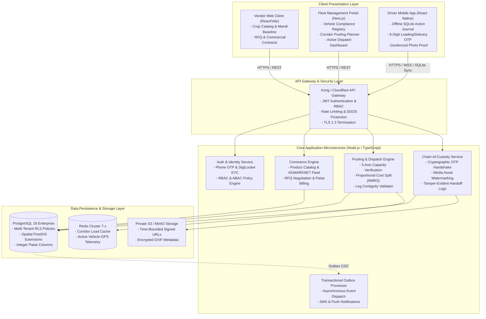
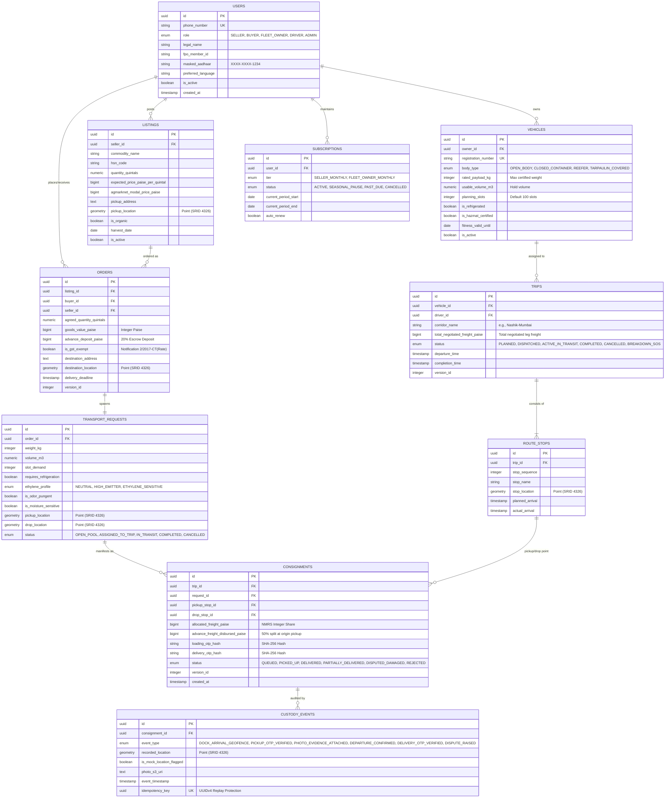
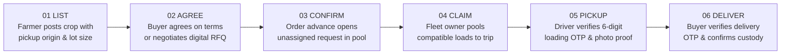
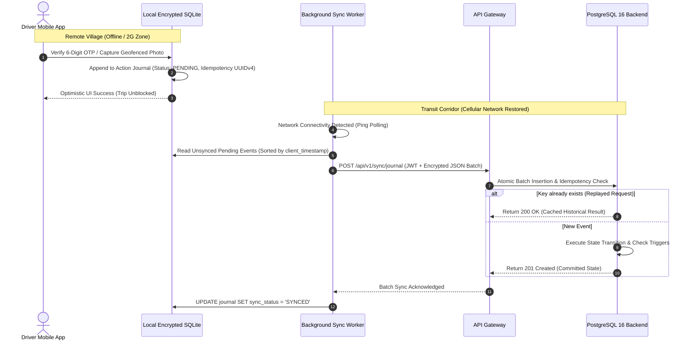
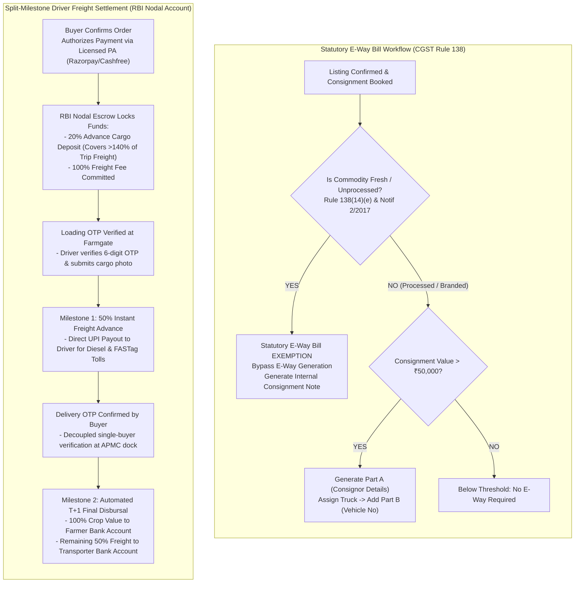

# 04. System Architecture & Technical Specifications

> **Tech4Bharat 2026** — _Theme 5: Retail, FMCG & Logistics_  
> **Problem Statement 5.3**: Rural Freight  
> **Team**: Kernal500  
> **Last Updated**: November 2026

---

> [!IMPORTANT]
>
> ### ⏱️ 30-Second Executive TL;DR & Judge Fast-Track
>
> - **The Core Architecture**: A full-stack, tri-client system (Vendor Web, Fleet Portal, Driver React Native Mobile App) backed by a hardened PostgreSQL 16 persistence engine, PostGIS spatial indexing, and strict Row-Level Security (RLS).
> - **Key Engineering Innovations**:
>   1. **Offline-First Resilience**: Driver mobile workflow runs on an encrypted on-device SQLite transactional journal with causal sync and idempotent replay, ensuring uninterrupted operations in 2G/zero-connectivity farm belts.
>   2. **Split-Milestone Driver Working-Capital Settlement**: Solves driver fuel starvation by disbursing 50% of freight instantly via UPI upon pickup OTP verification (backed by the buyer's 20% advance cargo escrow deposit, which covers >140% of the entire trip freight), with the remaining 50% paid upon decoupled delivery verification.
>   3. **Kernel-Level Capacity Enforcement**: Enforced via PostgreSQL PL/pgSQL trigger `validate_consignment_stops_and_capacity()`, preventing multi-leg truck overload at the database level.
> - **Judge Fast-Path (60 Seconds)**:
>   - Review the system component topology in [**Section 1: Mermaid Architecture Diagram**](#1-system-topology--architectural-principles).
>   - Review edge case workflows in [**Section 6: Comprehensive Edge-Case & Error Recovery Workflows**](#6-comprehensive-edge-case--error-recovery-workflows).
>   - Review driver cash-flow mechanics in [**Section 8: Statutory E-Way Bill & Payment Gateway Workflows**](#8-statutory-e-way-bill--payment-gateway-workflows).

---

## 1. System Topology & Architectural Principles

PRAYAAN’s system architecture is designed around three structural principles:

1. **Single Source of Operational Truth**: A unified PostgreSQL persistence engine and REST/WebSocket API manage order commerce, corridor fleet dispatch, and driver field execution, eliminating synchronization drift between commercial commitments and physical vehicle manifests.
2. **Offline-First Resilience**: Given severe cellular connectivity gaps across rural Indian farm belts, mobile driver workflows rely on an encrypted on-device SQLite transactional journal, causal replay, and idempotent network envelopes.
3. **Audited Statutory & Cryptographic Security**: Data access is governed by fine-grained Role-Based Access Control (RBAC), Attribute-Based Access Control (ABAC), and database Row-Level Security (RLS). All financial transactions are strictly computed in integer minor currency units (paise).



---

## 2. Tri-Client Functional Responsibilities

| Client Application    | Primary Target User                                                        | Key Functional Modules                                                                                                                                                                                                                                                                                                                           | Hardware / Runtime Profile                                                                                           |
| :-------------------- | :------------------------------------------------------------------------- | :----------------------------------------------------------------------------------------------------------------------------------------------------------------------------------------------------------------------------------------------------------------------------------------------------------------------------------------------- | :------------------------------------------------------------------------------------------------------------------- |
| **Vendor Web App**    | Smallholder Farmers, FPO Managers, Cottage MSMEs, Wholesale Buyers         | - Crop listing with commodity classification.<br>- Daily AGMARKNET mandi price baseline.<br>- RFQ negotiation and contract finalization.<br>- Advance order deposit authorization.<br>- Real-time corridor shipment tracking.<br>- Decoupled single-consignment delivery OTP generation.                                                         | Modern Web (Chrome / Firefox / Edge). Responsive layout optimized for desktop and mobile web.                        |
| **Fleet Portal**      | Regional Fleet Owners, Small Road Transport Operators (SRTOs), Dispatchers | - Commercial vehicle compliance registry (RC, fitness, permit, insurance, body type).<br>- Corridor-based open transport request discovery.<br>- Interactive 3-axis pooling & capacity audit planner.<br>- Automated fair-share freight split calculation.<br>- Live driver dispatch and stop sequencing.<br>- Automated driver settlement logs. | Web application optimized for desktop and tablet screens (Next.js 14, TailwindCSS).                                  |
| **Driver Mobile App** | Truck Drivers, Owner-Drivers                                               | - Stop-by-stop route checklist with offline navigation.<br>- 6-digit loading bay OTP entry.<br>- Tamper-evident photo capture at origin and destination docks.<br>- Geofenced dock arrival confirmation.<br>- Background GPS beacon (duty-hours only).<br>- Encrypted local SQLite action journal for offline sync.                              | Native Android (React Native / Expo). Lightweight ($< 35\text{ MB}$), functional on Android 9+, Android Go, 2GB RAM. |

---

## 3. Database Entity-Relationship Architecture (PostgreSQL 16)



> **Executable Schema Specification**:  
> The full production DDL with PostGIS geometry extensions, foreign key cascades, partial indexes, and PostgreSQL Row-Level Security policies is codified in [`schema.sql`](schema.sql) in the repository root.

---

## 4. End-to-End Operational Lifecycle & State Transitions

PRAYAAN enforces a six-stage deterministic state transition machine governing order and custody lifecycles:



### Stage 01: Crop Listing (`LIST`)

- The producer registers available crop inventory specifying commodity, quantity, harvest date, and GPS pickup coordinates.
- AGMARKNET daily wholesale modal prices are fetched and displayed side-by-side as market context. Seller maintains full pricing autonomy.

### Stage 02: Commercial Negotiation & Contracting (`AGREE`)

- Buyer discovers listing and initiates a bilateral negotiation via digital Request for Quotation (RFQ).
- Terms converge on agreed quantity, unit price (in integer paise), destination APMC mandi/warehouse, and expected delivery window.

### Stage 03: Order Advance & Request Broadcast (`CONFIRM`)

- Buyer authorizes an advance payment (typically 20% order advance deposit) held in an RBI-compliant Payment Aggregator nodal escrow account.
- System snapshots the contract and generates an unassigned **Transport Request** broadcast immediately to the open corridor pool.

### Stage 04: Corridor Pooling & Dispatch Assignment (`CLAIM`)

- Fleet owners discover pending transport requests filtered by active highway corridor buffers.
- The pooling engine validates candidate combinations against vehicle physical capacity ($W_V, U_V, S_V$) and cargo compatibility rules.
- Once validated, the trip manifest is generated, freight is allocated via the integer NMRS algorithm, and a driver is assigned.

### Stage 05: Loading Bay Custody Handshake (`PICKUP`) & Driver Advance Disbursal

- At the rural origin dock, the seller generates a time-bounded 6-digit cryptographic verification code on their mobile client.
- The driver inspects produce, enters the code on their mobile app, and uploads a mandatory geotagged, timestamped photo of the loaded cargo hold.
- Backend verifies the OTP hash and anti-spoofing flags before authorizing trip departure.
- **Split-Milestone Driver Working-Capital Settlement (50% Advance Disbursal)**:
  - Small fleet owners and rural owner-drivers frequently suffer from severe liquidity constraints, lacking working capital to pay for upfront diesel and FASTag highway tolls. In traditional markets, this forces drivers to take daily high-interest loans (3%–5% per month) from informal commission agents.
  - PRAYAAN resolves this friction deterministically: Upon successful `PICKUP_OTP_VERIFIED`, the platform immediately triggers an instant UPI transfer releasing **50% of the allocated leg freight** (`advance_freight_disbursed_paise = 0.50 * allocated_freight_paise`) directly to the transporter or driver's verified account.
  - **Financial Safety & Collateralization**: This advance is 100% collateralized because the buyer has already locked a **20% advance order deposit** in the licensed Payment Aggregator nodal escrow account during Stage 03 (`CONFIRM`). Because road freight typically represents only 10%–14% of the commodity value in agricultural shipments, the buyer's 20% cargo deposit covers **over 140% of the total freight fee**, completely insulating the platform from credit default.

### Stage 06: Decoupled Multi-Buyer Delivery (`DELIVER`)

- Upon arrival at respective destination stops, each buyer inspects their specific consignment.
- Buyer enters their delivery confirmation OTP. Consignment 1 transitions to `DELIVERED`, triggering automatic release of the remaining **50% freight balance** to the fleet owner, alongside the net crop value disbursement to Seller 1.
- Other pooled consignments remain active on the vehicle until verified at subsequent stops. Trip closes to `COMPLETED` when all consignments reach terminal status.

---

## 5. Offline Fault Tolerance & Synchronization Protocol

To ensure seamless field execution in remote rural areas with zero cellular reception, the Driver Mobile App operates an **Offline-First Synchronization Engine**:



### Protocol Technical Guarantees:

1. **Idempotency Guarantee**: Every mobile action generates an unchangeable UUID-v4 idempotency key. Duplicate replay attempts due to packet drops return the cached server confirmation without double-mutating database state.
2. **Causal Ordering**: Actions are sequenced by a local monotonically increasing integer counter (`seq_id`). The backend rejects or buffers out-of-order state transitions (e.g., delivery cannot be processed before pickup).
3. **Conflict Resolution**: The backend server clock is the ultimate authority for state transitions. If a conflict arises (e.g., trip was cancelled by fleet owner while driver was offline loading cargo), the system flags the consignment for `SUPERVISOR_MEDIATION` while preserving all cryptographic local event logs.

---

## 6. Comprehensive Edge-Case & Error Recovery Workflows

The platform embeds deterministic recovery routines for ten critical rural freight failure modes:

|   #    | Operational Failure Mode                    | System Detection Mechanism                                                              | Automated Recovery & Mitigation Workflow                                                                                                                                                                                                                                        |
| :----: | :------------------------------------------ | :-------------------------------------------------------------------------------------- | :------------------------------------------------------------------------------------------------------------------------------------------------------------------------------------------------------------------------------------------------------------------------------ |
| **01** | **Shipper Cancellation Prior to Dispatch**  | Seller cancels transport request via web portal.                                        | - If cancelled $\ge 2\text{ hrs}$ before scheduled pickup: 100% refund of freight commitment.<br>- If cancelled $< 2\text{ hrs}$ before pickup: Transporter receives unrecoverable dispatch compensation ($10\%$ trip freight); vehicle capacity is released back to open pool. |
| **02** | **Origin Farmgate Loading Delay**           | Driver arrives at dock; farmer produce is unharvested or delayed $> 60\text{ mins}$.    | Driver triggers `DOCK_WAIT_TIMEOUT`. Platform alerts shipper with 30-minute grace countdown. If unfulfilled, driver is authorized to depart; delinquent order is unassigned, and shipper is billed standard truck detention charges (₹250/hour).                                |
| **03** | **Driver Trip Rejection**                   | Assigned driver declines trip assignment on mobile client.                              | Trip status reverts to `PENDING_DRIVER_ASSIGNMENT`. Fleet portal highlights vehicle with high-priority audio alert; dispatcher reassigns backup driver within 15 minutes without canceling pooled shipper bookings.                                                             |
| **04** | **Vehicle Mechanical Breakdown in Transit** | Driver presses SOS breakdown alert; GPS halts on highway.                               | Platform partitions trip into completed vs. pending legs. Pro-rata freight for completed mileage is locked. Emergency transshipment broadcast dispatches nearby registered empty vehicle within 25 km; cargo shifted via dual-device QR handshake.                              |
| **05** | **Partial Consignment Delivery**            | Buyer inspects load and accepts only 70 out of 100 gunny sacks due to wet rot.          | Driver logs partial delivery: `ACCEPTED: 70`, `REJECTED: 30`. High-resolution photos captured. Commercial invoice is automatically amended in integer paise; buyer pays for 70 bags, and rejected produce is retained for insurer salvage inspection.                           |
| **06** | **Damaged or Missing Cargo Dispute**        | Consignee claims produce was stolen or severely crushed in transit.                     | Platform pulls immutable origin loading photo and compares against destination handover photo. If damage occurred in transit, carrier liability insurance is triggered; if damage was pre-existing (visible in origin photo), seller is held liable.                            |
| **07** | **Offline GPS Telemetry Blind Spots**       | Cellular signal lost in hilly or forested ghat sections for $> 2\text{ hours}$.         | Driver client buffers GPS coordinates at 60-second intervals to SQLite. Platform marks tracking as `OFFLINE_INTERPOLATED` using last known corridor heading. Immediate back-sync upon emerging into cellular coverage.                                                          |
| **08** | **Duplicate Network API Submissions**       | Shaky 2G connection causes driver to tap "Confirm Loading" 5 times in rapid succession. | API Gateway detects identical `Idempotency-Key` UUID. First request executes; subsequent 4 requests return identical HTTP 200 payload from Redis cache without creating redundant database entries.                                                                             |
| **09** | **Conflicting Concurrent Updates**          | Seller amends delivery address while Fleet Owner is assigning driver to route.          | PostgreSQL optimistic concurrency control detects mismatched `version_id`. The second transaction aborts with HTTP 409 Conflict, presenting user with refreshed state to re-validate compatibility.                                                                             |
| **10** | **Destination Mandi Dock Congestion**       | Mandi gate congested; truck queued for 6 hours past delivery window.                    | Driver geofence confirms arrival at APMC perimeter. Delivery SLA timer is paused; consignee is notified; demurrage detention clock begins automatically.                                                                                                                        |

---

## 7. Security Architecture, Privacy & Statutory Compliance

### A. Realistic Database Row-Level Security (RLS) Posture

PostgreSQL Row-Level Security (RLS) provides strong intra-database tenant isolation, but must never be described as "impenetrable." PRAYAAN documents both its protection layers and structural attack vectors:

```sql
-- Production RLS Policy: Non-Recursive Inspection via SECURITY DEFINER Helpers
ALTER TABLE consignments ENABLE ROW LEVEL SECURITY;

CREATE POLICY consignments_select_policy ON consignments
    FOR SELECT
    USING (
        is_request_party(request_id, get_current_app_user_id())
        OR is_trip_operator(trip_id, get_current_app_user_id())
        OR is_app_admin()
    );

CREATE POLICY consignments_update_policy ON consignments
    FOR UPDATE
    USING (
        is_trip_operator(trip_id, get_current_app_user_id())
        OR is_app_admin()
    )
    WITH CHECK (
        is_trip_operator(trip_id, get_current_app_user_id())
        OR is_app_admin()
    );
```

#### Known RLS Attack Vectors & Mitigations:

1. **Application Connection Superuser Bypass**: Application backend services must connect via a strictly unprivileged database role (`app_service_role`). Connecting via `postgres` superuser bypasses all RLS policies unconditionally.
2. **Function Side-Effects in Policies**: All security functions are marked `SECURITY DEFINER` and execute with immutable `search_path` to prevent SQL injection via user schema overriding.
3. **Connection Pooling Leaks**: When using connection poolers (e.g., PgBouncer), session settings (`app.current_user_id`) must be explicitly reset using `DISCARD ALL` or scoped within local database transactions (`SET LOCAL`) to prevent cross-tenant session bleeding.

### B. Driver Location Privacy & DPDP Act 2023 Compliance

In accordance with the **Digital Personal Data Protection Act, 2023**:

1. **Duty-Mode Tracking Only**: The Driver Mobile App captures background GPS coordinates **only when an assigned trip is in `ACTIVE` status**. Once the final consignment is confirmed delivered, background location services are terminated immediately.
2. **Coordinate Fuzzing**: For residential farm locations, public customer tracking screens display coordinates fuzzed by a 500-meter Gaussian noise envelope, revealing precise GPS pins only to the assigned driver.
3. **Data Retention**: Granular GPS telemetry pings are purged after 90 days; only aggregated corridor transit performance metrics are retained for routing analytics.

### C. Aadhaar & Sensitive KYC Safeguards

To comply with UIDAI regulations and RBI guidelines:

- PRAYAAN **strictly forbids the storage of full 12-digit Aadhaar numbers or biometric data** in any system database.
- User identity is verified via **DigiLocker tokenized OAuth 2.0 flow** or via **Masked Aadhaar OCR** where only the last 4 digits are persisted (`XXXX-XXXX-1234`).
- All vehicle registration (RC) and commercial permit records are verified programmatically against the Ministry of Road Transport and Highways (MoRTH) **VAHAN API** via the Unified Logistics Interface Platform (ULIP).

### D. Anti-Spoofing & Geofence Verification

To prevent fraudulent collection of freight payments or falsified delivery evidence:

1. **Android Mock Location Detection**: The mobile client interrogates Android Location APIs (`Location.isFromMockProvider()`); any attempt to inject synthetic GPS coordinates immediately locks the application and raises a fraud flag.
2. **EXIF Metadata Cross-Check**: Uploaded loading-bay photos must contain raw camera sensor metadata matching the physical device model and GPS coordinates within 200 meters of the declared pickup dock.
3. **Cell-Tower & Wi-Fi Corroboration**: At each OTP verification event, the app samples nearby GSM cell tower IDs to cross-verify against GPS coordinates.

---

## 8. Statutory E-Way Bill & Payment Gateway Workflows



### Deterministic 50/50 Split-Milestone Freight Disbursal Policy

To solve the structural working capital deficit faced by rural truck drivers without incurring unhedged credit risk:

1. **Collateralized Escrow Buffer**: Agricultural freight typically represents 10%–14% of the commodity value. When the buyer commits the standard **20% advance cargo deposit**, this deposit holds enough capital to cover **140% to 200% of the total freight charges**.
2. **Milestone 1 (50% at Pickup)**: Upon driver entry of the 6-digit loading bay OTP and submission of cargo photo proof (`PICKUP_OTP_VERIFIED`), the system issues an automated payment webhook to the licensed Payment Aggregator, immediately transferring 50% of the allocated leg freight (`advance_freight_disbursed_paise`) to the transporter via UPI. This funds on-corridor diesel and FASTag toll expenses.
3. **Milestone 2 (50% at Delivery)**: Upon buyer verification of the delivery OTP (`DELIVERY_OTP_VERIFIED`), the remaining 50% freight balance is released alongside the net crop value payout to the farmer. If a delivery dispute arises, the remaining 50% freight and crop balance are held in escrow pending 30-minute photo arbitration.

### Clarification on "Escrow" & Banking Integrations

To maintain absolute compliance with RBI regulations:

- PRAYAAN does **not** operate an internal banking wallet or unlicensed escrow pool.
- All funds flow through a **commercial Payment Aggregator (Razorpay / Cashfree) operating an RBI-regulated Nodal / Escrow Account** under the Payment and Settlement Systems Act, 2007.
- In prototype demonstrations, payment webhooks are clearly designated `SIMULATED_GATEWAY_SANDBOX`.
