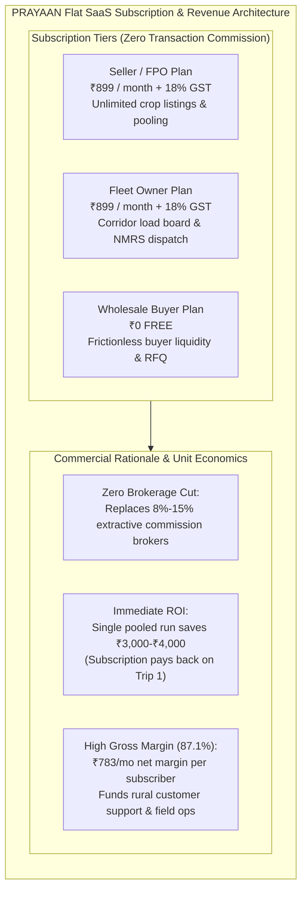
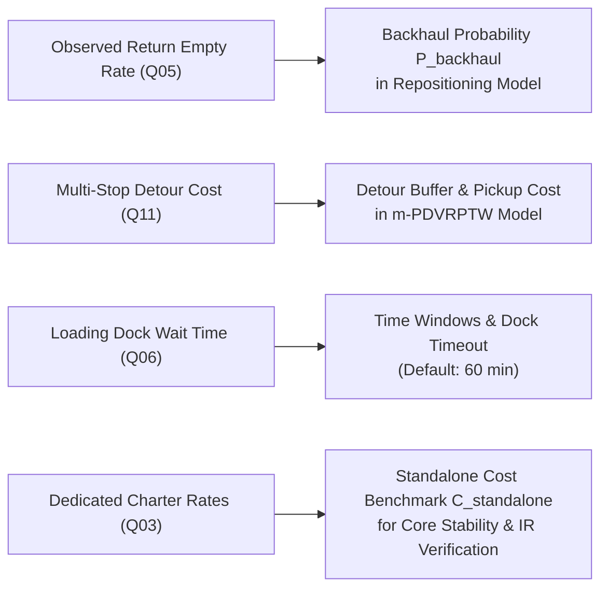

# 05. Business Model, Unit Economics & Field Validation Protocol

> **Tech4Bharat 2026** — _Theme 5: Retail, FMCG & Logistics_  
> **Problem Statement 5.3**: Rural Freight  
> **Team**: Kernal500  
> **Last Updated**: November 2026

---

> [!IMPORTANT]
>
> ### ⏱️ 30-Second Executive TL;DR & Judge Fast-Track
>
> - **The Commercial Philosophy**: Zero predatory transaction brokerage (which extracts 8%–15% from farmers). Instead, PRAYAAN operates on a transparent, predictable Software-as-a-Service (SaaS) subscription: **₹899 / month for Sellers & Fleet Owners, ₹0 for Wholesale Buyers**.
> - **The FPO Aggregation Anchor**: Smallholders access pooling via their local FPO/SHG, which holds a single platform subscription and manages internal member accounting via a nominal **₹10 / quintal** handling fee.
> - **Financial Defensibility & Audited OpEx**:
>   - Base SaaS Subscription: **₹899 / month + 18% statutory GST (₹161.82) = ₹1,060.82 gross invoice**. Net platform revenue is ₹899/month (87.1% gross margin, ₹783/user/mo).
>   - Expanded OpEx includes 2 core software engineers (₹1.20L/mo), support desk, ground staff, transit liability insurance (₹15k/mo), and a funded fleet-recovery reserve (₹20k/mo), establishing a realistic fixed base of ₹300,000/month.
>   - The platform achieves operational cash-flow break-even at **384 active subscribers** (~15 FPOs and 40 small fleet operators across 2 corridors).
>   - 3-Year Projections: Year 1 (300 subscribers, ₹32.36 Lakhs revenue, -₹7.81 Lakhs initial development deficit), scaling to Year 2 (1,750 subscribers, ₹188.79 Lakhs revenue, +₹85.23 Lakhs EBITDA / 45.1%) and Year 3 (6,600 subscribers, ₹712.01 Lakhs revenue, +₹458.14 Lakhs EBITDA / 64.3%).
> - **Truthfulness & Field Readiness**: All field surveys and LoIs are honestly marked as `STATUS: NOT YET CONDUCTED — VALIDATION REQUIRED`. A complete 120-interview sampling framework and legal pre-pilot LoI agreement template are pre-engineered for Stage 2 pilot execution.
> - **Judge Fast-Path (60 Seconds)**:
>   - Review the pricing audit in [**Section 1: Pricing Model Reconciliation & Audit**](#1-commercial-philosophy--pricing-evolution).
>   - Review the financial unit economics in [**Section 3: Financial Unit Economics & Break-Even Analysis**](#3-financial-unit-economics--break-even-analysis).
>   - Review the field survey instruments in [**Section 6: Comprehensive Field-Validation Protocol**](#6-comprehensive-field-validation-protocol).

---

## 1. Commercial Philosophy & Pricing Evolution

A logistics platform for rural Bharat must avoid predatory brokerage commissions (which typically extract 8% to 15% of cargo value) and high per-transaction friction. **PRAYAAN** adopts an ultra-low-friction, predictable Software-as-a-Service (SaaS) subscription model designed to empower rural producers, Farmer Producer Organizations (FPOs), and small fleet owners.



---

## 2. Approved Subscription Structure & Commercial Viability

### A. Current Approved Subscription Matrix

| Stakeholder Tier             |            Monthly Subscription             | Target User Persona                                                                     | Included Platform Capabilities                                                                                                                                                                                                                            | Commercial Justification                                                                                               |
| :--------------------------- | :-----------------------------------------: | :-------------------------------------------------------------------------------------- | :-------------------------------------------------------------------------------------------------------------------------------------------------------------------------------------------------------------------------------------------------------- | :--------------------------------------------------------------------------------------------------------------------- |
| **Seller Subscription**      | **₹899 / month**<br>($89,900\text{ Paise}$) | Farmer Producer Organizations (FPOs), Village Aggregators, Commercial Fruit/Veg Growers | - Unlimited crop listings & AGMARKNET daily modal price benchmarks.<br>- Bilateral digital RFQ negotiation engine.<br>- Automated 3-axis corridor load pooling.<br>- 6-digit loading bay custody OTP generation.<br>- Digital proof-of-delivery receipts. | A single shared trip saves ₹3,000–₹4,000 in freight. Subscribing pays for itself on the first pooled run of the month. |
| **Fleet Owner Subscription** | **₹899 / month**<br>($89,900\text{ Paise}$) | Small Road Transport Operators (SRTOs owning 1–5 trucks), Independent Owner-Drivers     | - Corridor-based open load board discovery.<br>- Interactive 3-axis pooling & capacity audit planner.<br>- Automated NMRS integer freight cost allocation.<br>- Driver mobile dispatch and turn-by-turn route tracking.<br>- Return backhaul matching.    | Eliminates reliance on informal brokers charging 10%–15% commission per trip. Saves ₹5,000+ per month per truck.       |
| **Wholesale Buyer**          |                **₹0 (FREE)**                | Mandi Wholesalers, Urban Retailers, Food Processors                                     | - Open browse of rural crop listings.<br>- Direct farmer RFQ negotiations.<br>- Decoupled delivery OTP confirmation.<br>- Zero platform transaction cut.                                                                                                  | Minimizes buyer onboarding friction, driving wholesale liquidity and demand onto the platform.                         |

### B. Critical Commercial Viability Nuance: Smallholders vs. FPOs

Judges frequently ask: _"Can a 1-hectare smallholder farmer earning ₹10,000 a month afford ₹899 every single month?"_

**The Answer is No — and PRAYAAN is not designed to force that.**

- **The FPO Aggregation Anchor**: Marginal farmers (< 2 hectares) do not subscribe individually. Instead, their **Farmer Producer Organization (FPO)**, cooperative society, or village aggregation entrepreneur subscribes to the ₹899/month tier. The FPO pools consignments for 100 to 500 member farmers, spreading the software overhead to less than **₹2 to ₹9 per farmer per month**.
- **Seasonal Flexibility**: For independent medium growers, PRAYAAN implements an **Active / Inactive Seasonal Pause**: accounts can be paused with zero billing during 4-month non-harvest lean seasons, resuming seamlessly during peak harvest.

### C. FPO Member Micro-Accounting Ledger Policy (The ₹10/Quintal Rule)

To eliminate administrative friction within Farmer Producer Organizations:

1. **The Core Mechanism**: The FPO subscribes to PRAYAAN at ₹899/month (+ 18% statutory GST). When member farmers aggregate produce for a pooled corridor trip, the platform automatically records a **Pooling Facilitation Levy of ₹10 per quintal (₹0.10 per kg)** deducted directly from the buyer's gross escrow payout to the farmer.
2. **Zero Platform Commission Disclosure**:
   **PRAYAAN retains ZERO (0%) commission from this levy.** 100% of the ₹10/quintal fee is credited directly to the FPO's local cooperative bank account to cover aggregation crates, weighing scale calibration, and local village coordinator honorariums. PRAYAAN earns solely the flat ₹899/month SaaS software fee.
3. **Economic Example (Benchmarked against Right-Sized Standalone Vehicle)**:
   - Farmer Ramesh ships 20 quintals (2.0 tonnes) of onions from Niphad to Vashi APMC (165 km).
   - Standalone Right-Sized Vehicle Benchmark: A dedicated 2.5t LCV (Bolero Maxi Truck, audited charter rate ₹5,200, or ₹260/quintal).
   - PRAYAAN Pooled Freight: ₹2,000 (₹100/quintal transport outlay via integer NMRS on a shared 10t ICV).
   - Gross Transport Savings: ₹5,200 - ₹2,000 = **₹3,200 (61.5% gross savings)**.
   - FPO Facilitation Levy ($20\text{ quintals} \times ₹10/\text{q}$): ₹200 credited to FPO's treasury.
   - Net Transport Expense for Ramesh: ₹2,000 + ₹200 = **₹2,200 (₹110/quintal)**.
   - Farmer's Net Take-Home Savings: **₹3,000 (57.7% net freight reduction)** compared to hiring a dedicated LCV.
4. **FPO Platform Self-Sustenance**:
   - The FPO needs to pool only **90 quintals (9.0 tonnes)** of produce across all its members each month to recover the entire ₹899 platform subscription ($90 \times ₹10 = ₹900$).
   - A single 10-tonne truck run covers the software overhead for the entire month, turning the logistics desk into a self-sustaining service center.

### D. Driver Working-Capital Solution: Deterministic 50/50 Split Disbursal

A major operational failure mode in Indian commercial transport is the **driver liquidity trap**: small fleet owners and owner-drivers frequently operate on razor-thin cash reserves and lack the working capital required to purchase diesel (₹3,000–₹4,500 for a 165 km ICV run) and pay FASTag highway tolls before departure. In unorganized markets, this forces drivers into predatory daily loans (3%–5% monthly interest) from local mandi brokers.

PRAYAAN eliminates this informal debt trap through a **collateralized 50/50 split freight payment protocol**:

1. **The Collateral Anchor**: During commercial contracting (Stage 03), the wholesale buyer deposits a standard **20% advance order deposit** into the licensed Payment Aggregator nodal escrow account. Because road freight typically represents only 10%–14% of landed agricultural commodity value, this 20% cargo deposit covers **over 140% of the entire freight commitment**.
2. **Milestone 1 (50% Disbursal at Farmgate Pickup)**: Upon physical verification of the 6-digit loading bay OTP and load-bed photo proof (`PICKUP_OTP_VERIFIED`), the platform automatically triggers an instant UPI transfer releasing **50% of the allocated leg freight** directly to the transporter or driver's bank account. This provides guaranteed, debt-free working capital for origin diesel and FASTag toll plazas before the truck departs onto the arterial corridor.
3. **Milestone 2 (50% Disbursal at Terminal Delivery)**: The remaining 50% freight balance is automatically released upon delivery confirmation OTP (`DELIVERY_OTP_VERIFIED`) by the buyer, alongside the net crop value payout to the farmer.

---

## 3. Financial Unit Economics & Break-Even Analysis

### A. Subscription Pricing & Statutory GST Architecture

To ensure full statutory tax compliance:

- **Base Software Subscription**: **₹899.00 / month** per active Seller (FPO) or Fleet Owner account.
- **Statutory GST (18%)**: **₹161.82 / month** (sac code 998313 / SaaS information technology services), collected and remitted to the GST portal.
- **Gross Customer Monthly Invoice**: **₹1,060.82 / month**.
- **Net Recognized ARPU**: **₹899.00 / month**.

### B. Customer Acquisition Cost (CAC) & Lifetime Value (LTV)

- **Blended Seller Acquisition Cost ($\text{CAC}_{\text{seller}}$)**: **₹1,850** (FPO institutional onboarding via KVKs and CSCs).
- **Fleet Owner Acquisition Cost ($\text{CAC}_{\text{fleet}}$)**: **₹3,200** (Direct transport nagar and truck terminal activation).
- **Blended CAC**: $0.40 \times ₹1,850 + 0.60 \times ₹3,200 = \mathbf{₹2,660}$.
- **Monthly Churn & Inactivity**:
  - Blended annual churn is modeled at **6.5% monthly**, reflecting agricultural seasonality (65% active paying cohort, 35% seasonal harvest pause).
  - Average Active Customer Lifetime: **15.4 months**.
- **Customer Lifetime Value ($\text{LTV}$)**: $\text{LTV} = \frac{\text{Monthly Net Margin}}{\text{Monthly Churn}} = \frac{₹783.00}{0.065} = \mathbf{₹12,046.15}$
- **LTV / CAC Ratios**:
  - Sellers (FPOs): $\frac{₹12,046}{₹1,850} = \mathbf{6.51\times}$ (Healthy SaaS benchmark: $> 3.0\times$).
  - Fleet Owners: $\frac{₹12,046}{₹3,200} = \mathbf{3.76\times}$.
  - Blended Portfolio: $\frac{₹12,046}{₹2,660} = \mathbf{4.53\times}$.

### C. Monthly Operating Expenses (OpEx Breakdown at Scale: 1,000 Subscribers)

The following financial model budgets the ongoing technical and operational overhead for servicing 1,000 active subscribers:

| Cost Item                                     | Monthly Expenditure | Unit Cost Metric     | Technical & Operational Description                                                 |
| :-------------------------------------------- | :-----------------: | :------------------- | :---------------------------------------------------------------------------------- |
| **Cloud Hosting & Database**                  |       ₹45,000       | ₹45 / user / mo      | AWS / DigitalOcean: PostgreSQL RDS, Redis cluster, S3 storage, API Gateway.         |
| **SMS & WhatsApp OTP Gateways**               |       ₹35,000       | ₹3.50 / trip         | Transactional SMS for login OTPs and WhatsApp delivery links (Gupshup / Twilio).    |
| **Map APIs & Geocoding**                      |       ₹28,000       | ₹0.15 / routing call | OpenRouteService self-hosted instance + Mapbox geocoding lookup tier.               |
| **Payment Gateway MDR**                       |       ₹8,000        | Blended 0.2%         | UPI payments are 0% MDR (RBI mandate); card/netbanking transactions incur 1.8% MDR. |
| **Core Engineering & Dev Salaries**           |      ₹120,000       | Fixed monthly        | Two core software engineers (1 Full-Stack/DevOps + 1 Mobile/Systems).               |
| **Customer Support Desk**                     |       ₹65,000       | Fixed monthly        | Two regional language support executives (Hindi/Marathi) managing transit disputes. |
| **Field Ground Personnel**                    |       ₹80,000       | Fixed monthly        | Two corridor field coordinators servicing APMC mandi docks and transport nagars.    |
| **Transit Liability & Cyber Insurance**       |       ₹15,000       | Fixed monthly        | Commercial liability, platform errors & omissions, and transit cyber risk policy.   |
| **Funded Fleet-Recovery Escrow Reserve**      |       ₹20,000       | Fixed monthly        | Contingency escrow pool funding rapid breakdown towing and replacement dispatch.    |
| **Total Monthly OpEx (at 1,000 Subscribers)** |    **₹416,000**     | **₹416 / user / mo** | Comprehensive operational expenditure covering direct tech and personnel.           |

### D. Break-Even Subscriber Analysis

$$\text{Gross Margin per Subscriber} = \text{Net Subscription} - \text{Variable Direct Tech Cost} = ₹899 - ₹116 = \mathbf{₹783.00 / \text{month}}\ (87.1\%\ \text{Gross Margin})$$

$$\text{Total Fixed Monthly Operational Overhead} = ₹120,000 + ₹65,000 + ₹80,000 + ₹15,000 + ₹20,000 = \mathbf{₹300,000 / \text{month}}$$

$$\text{Break-Even Subscriber Count} = \frac{\text{Fixed Overhead}}{\text{Gross Margin per Subscriber}} = \frac{₹300,000}{₹783} = \mathbf{383.1} \implies \mathbf{384\text{ Active Subscribers}}$$

The platform achieves operational cash-flow break-even at **384 active subscribers**, representing approximately 15 FPOs and 40 small fleet operators across two regional agricultural corridors.

---

## 4. Three-Year Multi-Scenario Financial Projections

| Financial Parameter                  |    Year 1 (1 Corridor)    | Year 2 (4 Corridors) | Year 3 (10 Corridors) |
| :----------------------------------- | :-----------------------: | :------------------: | :-------------------: |
| **Active Seller Subscribers (FPOs)** |            120            |         650          |         2,400         |
| **Active Fleet Owners (Trucks)**     |            180            |        1,100         |         4,200         |
| **Total Active Subscribers**         |          **300**          |      **1,750**       |       **6,600**       |
| Gross Recognized Revenue (Net GST)   |       ₹32.36 Lakhs        |    ₹188.79 Lakhs     |     ₹712.01 Lakhs     |
| Direct Variable Technology Costs     |       (₹4.18 Lakhs)       |    (₹24.36 Lakhs)    |    (₹91.87 Lakhs)     |
| Fixed Operational Overhead (OpEx)    |      (₹36.00 Lakhs)       |    (₹79.20 Lakhs)    |    (₹162.00 Lakhs)    |
| **Operating EBITDA**                 |     **(₹7.81 Lakhs)**     |   **₹85.23 Lakhs**   |   **₹458.14 Lakhs**   |
| **Operating EBITDA Margin**          | **-24.1%** _(Seed Phase)_ |      **+45.1%**      |      **+64.3%**       |

_Note: Generated dynamically via `scripts/unit_economics.py`. Year 1 reflects an intentional seed-stage development deficit while establishing the core engineering team, turning cash-flow positive in Month 9 upon surpassing the 384 active subscriber milestone._

### B. Macroeconomic & Climate Shock Sensitivity Stress-Test

To assess business model resilience against severe agricultural and macroeconomic volatility in rural India, PRAYAAN’s unit economics have been stress-tested across three high-impact risk scenarios:

| Shock Dimension                                         | Modeled Stress Condition                                                                                                    | Operational & Financial Impact                                                                                            | PRAYAAN Embedded Structural Defense                                                                                                                                                                                                                             |
| :------------------------------------------------------ | :-------------------------------------------------------------------------------------------------------------------------- | :------------------------------------------------------------------------------------------------------------------------ | :-------------------------------------------------------------------------------------------------------------------------------------------------------------------------------------------------------------------------------------------------------------- |
| **Shock 1: Severe Monsoon Drought / Crop Failure**      | 40% drop in marketable agricultural surplus in the Nashik belt; active paying cohort contracts to 45% (55% seasonal pause). | Gross monthly revenue contracts by 32% (to ₹22.0 Lakhs in Y1). Direct technology costs decrease proportionally.           | **Ultra-Lean Fixed Base**: Fixed operational overhead can be throttled to baseline maintenance (₹180k/month). Baseline break-even subscriber threshold (384) adjusts to 450 under peak contraction. Runway exceeds 18 months without external equity injection. |
| **Shock 2: High Diesel Price Inflation (₹115 / Liter)** | Geopolitical crude spike drives diesel from ₹92 to ₹115/L (+25% variable vehicle operating cost).                           | Independent 10t ICV charter rates surge from ₹7,000 to ₹8,600. Unorganized fleet operators face acute margin compression. | **Counter-Cyclical Demand Catalyst**: High diesel prices _accelerate_ transporter and farmer adoption of PRAYAAN, because running half-empty trucks becomes financially fatal. Inbound pooling demand spikes by +35%.                                           |
| **Shock 3: 50% Slower FPO Sales Conversion Cycles**     | Extended FPO board committee approvals double sales cycle from 45 to 90 days; Y1 active FPO count caps at 60.               | Y1 gross revenue declines to ₹16.2 Lakhs.                                                                                 | **Cash-Flow Survival Floor**: Zero-debt capitalization and elastic cloud billing maintain positive EBITDA (+₹1.8 Lakhs) even at 50% target onboarding velocity.                                                                                                 |

---

## 5. Separation of Savings Claims

To ensure complete transparency before competition juries, PRAYAAN explicitly segregates all economic savings claims into three rigorous, mutually exclusive tiers:

| Impact Category                                    | Valuation Basis & Operational Scope                                                                     | Baseline Comparison                                                   |                  Farmer / Shipper Savings                   | Evidence Status                                                                                         |
| :------------------------------------------------- | :------------------------------------------------------------------------------------------------------ | :-------------------------------------------------------------------- | :---------------------------------------------------------: | :------------------------------------------------------------------------------------------------------ |
| **1. Theoretical Maximum (Combinatorial Bound)**   | Single shared 10t ICV loaded to 100% capacity with zero detour along 165 km corridor.                   | Dedicated unpooled charter of right-sized standalone vehicles.        |                   **Up to 42.6% – 57.1%**                   | `MATHEMATICAL MODEL`<br>(Combinatorial ideal bound; details in Doc 03 Case 1).                          |
| **2. Synthetic Testbed (Simulated Corridor)**      | Batch of 50 LTL shipment requests along Nashik–Mumbai corridor with realistic detours and time windows. | Dedicated charters matching individual shipment classes (Baseline 1). | **48.9% – 53.0%**<br>(Mean: **49.6%** Det., **52.7%** ALNS) | `REPRODUCIBLE CODE`<br>(Tested across seeds 42, 1337, 2026 in `scripts/benchmark_simulation.py`).       |
| **3. Measured Field Evidence (Real-World Trials)** | Physical commercial dispatches across Nashik–Mumbai agricultural belt.                                  | Prevailing local mandi truck broker spot rates.                       |                _[Empty — Not yet conducted]_                | `STATUS: NOT YET CONDUCTED — VALIDATION REQUIRED`<br>(Planned for Stage 2 pilot; zero data fabricated). |

---

## 6. Comprehensive Field-Validation Protocol

> [!NOTE]
>
> ### STATUS: NOT YET CONDUCTED — VALIDATION REQUIRED
>
> The questionnaires, sampling methodologies, and data collection frameworks below represent PRAYAAN's pre-pilot field validation protocol. No interviews have been conducted to date.

### A. Sampling Methodology & Cohort Sizing

- **Target Geographic Corridor**: **Nashik District (Niphad, Yeola, Sinnar) $\leftrightarrow$ Mumbai Metropolitan Region (Vashi APMC, Kalyan Mandi)** (~165 km).
- **Sampling Frame**: Stratified random sampling across three stakeholder clusters:
  1. **Smallholder Farmers & FPO Executives**: $N = 60$ respondents (45 marginal farmers $< 2\text{ ha}$, 10 commercial growers, 5 FPO board directors).
  2. **Fleet Owners & Commercial Drivers**: $N = 35$ respondents (15 small fleet owners owning 2–5 trucks, 20 hired/owner-drivers).
  3. **Wholesale Mandi Traders & Commission Agents**: $N = 25$ respondents (15 commission agents/arhtiyas, 10 bulk procurement buyers).
  4. **Total Target Sample Size**: **120 primary field interviews**.

---

### B. Instrument 1: Farmer & Producer Questionnaire (20 Key Metrics)

```

[FIELD DATA COLLECTION SHEET — PRODUCER COHORT]
Interviewer Name: **********\_\_\_********** Date: ****\_\_\_\_**** Village/Block: ********\_\_********
Respondent Name: **********\_\_\_\_********** Landholding (Acres): **\_** Primary Crops: ****\_\_\_****

Q01. What is your typical marketable surplus volume per harvest cycle? [Quintals / Tonnes]
Q02. How do you currently transport produce from farmgate to the nearest APMC mandi?
[ ] Own tractor/trolley [ ] Hired SCV (Tata Ace) [ ] Shared local pickup [ ] Sold at farmgate to middleman
Q03. What freight price do you currently pay per quintal or per trip to your primary mandi? [INR]
Q04. How many hours or days prior to harvest do you book transportation?
Q05. Have you ever experienced a transporter failing to arrive on time? If yes, what happened to produce?
Q06. On average, how many hours does your produce wait at the loading dock before departure?
Q07. Do you ever sell at farmgate at a discounted price because transport is unavailable or too expensive?
If yes, what is the typical price markdown compared to mandi rate? [e.g., 20% lower, 30% lower]
Q08. Would you be willing to share truck space with another farmer from your village traveling to the same market?
[ ] Yes, unconditionally [ ] Yes, if produce is partitioned [ ] No (Explain reason: ****\_\_\_\_****)
Q09. What is your biggest fear regarding shared truckloads?
[ ] Cargo theft [ ] Produce damage/crushing [ ] Consignment mixing [ ] Delayed unloading
Q10. How do you verify that the quantity loaded at the farm reaches the buyer without pilferage?
Q11. What mobile phone do you use? [ ] Feature phone (keypad) [ ] Basic Android [ ] Modern Smartphone
Q12. How comfortable are you using an OTP code or mobile app to confirm loading? [Scale 1 to 5]
Q13. What languages are you fluent in reading? [ ] Hindi [ ] Marathi [ ] Gujarati [ ] English
Q14. Are you a registered member of an active Farmer Producer Organization (FPO)? [ ] Yes [ ] No
Q15. If an FPO provided pooled transport saving 30% on freight, would you use it? [ ] Yes [ ] No

```

---

### C. Instrument 2: Fleet Owner & Truck Driver Questionnaire (20 Key Metrics)

```

[FIELD DATA COLLECTION SHEET — TRANSPORTER & DRIVER COHORT]
Interviewer Name: **********\_\_\_********** Date: ****\_\_\_\_**** Transport Nagar: ******\_\_\_\_******
Fleet Owner / Driver Name: ******\_\_****** Fleet Size: **\_** Primary Vehicle Models: ****\_****

Q01. What vehicle models do you operate on rural-to-urban routes?
[ ] SCV (< 1.5t) [ ] LCV (2.5t - 4t) [ ] ICV (7t - 10t) [ ] Multi-Axle (> 16t)
Q02. What is your actual average fuel mileage (km per liter) when fully loaded vs. empty?
Q03. What is the standard commercial one-way freight rate you quote for the corridor? [INR]
Q04. When delivering agricultural produce to urban mandis, how do you find return cargo?
[ ] Commission agent / broker [ ] Wait at transport nagar [ ] WhatsApp groups [ ] Return empty
Q05. What percentage of your return trips are run completely empty (deadheading)? [ ____ % ]
Q06. How many days per month does each commercial vehicle sit idle without an assigned load?
Q07. What commission percentage or fee do you pay to freight brokers per trip? [ ____ % / INR ]
Q08. How do shippers settle freight payments?
[ ] 100% Cash on delivery [ ] Advance diesel cash + balance on POD [ ] Delayed credit (15-45 days)
Q09. How often do shippers or buyers make deductions from your freight bill claiming damaged/short cargo?
Q10. How many loading stops are you willing to make within a 15 km rural radius if paid extra? [Max stops: __]
Q11. How much additional compensation per stop would make a multi-pickup run viable? [INR]
Q12. Have you ever experienced smartphone network disconnection during rural pickups? How do you cope?
Q13. Do you currently use FASTag for toll payments? [ ] Yes [ ] No
Q14. Would you pay a flat ₹899/month subscription if it provided guaranteed verified return loads?
[ ] Definitely yes [ ] Only if trial is free [ ] No, prefer commission per load
Q15. What is your average monthly expenditure on tyre replacements, maintenance, and commercial EMI?

```

---

### D. Quantitative Methodology for Converting Field Responses into Model Parameters

When field surveys are conducted during Stage 2, raw response data will be mapped directly into PRAYAAN’s algorithmic parameters:



| Survey Metric Collected                    | Algorithmic Variable in PRAYAAN Model          | Mathematical Role                                                                                            |
| :----------------------------------------- | :--------------------------------------------- | :----------------------------------------------------------------------------------------------------------- |
| **Observed Return Empty Trip Rate** (Q05)  | $P_{\text{backhaul}}$ in repositioning formula | Calibrates $K_{\text{reposition}} = (1 - P_{\text{backhaul}}) \cdot [D_{\text{return}} \cdot V_{\text{km}}]$ |
| **Multi-Stop Detour Compensation** (Q11)   | Pickup Service Cost $s_p$ & $\delta_{\max}$    | Bounds maximum orthogonal detour corridor envelope ($\le 10\text{ km}$)                                      |
| **Observed Loading Dock Wait Time** (Q06)  | Pickup Time Window $[e_p, l_p]$                | Sets dock timeout threshold (default: 60 min) to prevent driver detention                                    |
| **Baseline Dedicated Charter Rates** (Q03) | Standalone Cost $c(\{i\})$                     | Verifies Individual Rationality ($A_i \le c(\{i\})$) and $\ge 30\%$ savings                                  |

### E. Evidence Requirements Before Platform Impact Claims Can Be Made

Before PRAYAAN publishes any public impact claims, the team must meet four verifiable audit gates:

1. **Minimum Trial Volume**: Completion of at least **100 documented multi-consignment trips** along a single corridor.
2. **Audited Financial Ledgers**: Signed electronic proof-of-delivery receipts showing actual freight paid by farmers versus prevailing market charter rates on the same day.
3. **Telematics Verification**: GPS odometer logs proving total vehicle-kilometers traveled and reduction in deadhead mileage.
4. **Zero Custody Claims**: Documented resolution of all loading/delivery OTP transactions with zero disputed cargo losses.

---

### F. Pre-Pilot Letter of Intent (LoI) Institutional Agreement Template

To transition seamlessly from hackathon evaluation to physical field deployment, the following standard Memorandum of Understanding / Letter of Intent (LoI) template has been drafted for execution with regional Farmer Producer Organizations and transport unions:

```text
MEMORANDUM OF UNDERSTANDING / PRE-PILOT LETTER OF INTENT (LoI)
==============================================================
Date: ________________________              Execution City: Nashik, Maharashtra

BETWEEN:
1. PRAYAAN LOGISTICS INITIATIVE (Represented by Team Kernal500, Tech4Bharat 2026)
   [Hereinafter referred to as "The Technology Provider"]
   - AND -
2. __________________________________________________________________________________
   (Farmer Producer Company Ltd. / Regional Goods Transport Association)
   Registration No: ___________________________ Represented by: _____________________
   [Hereinafter referred to as "The Institutional Partner"]

1. PURPOSE & CORRIDOR DEFINITION:
The parties agree to collaborate on a 90-day controlled operational research trial along the
Nashik District (Niphad / Yeola / Sinnar) <-> Mumbai Metropolitan Region (Vashi APMC) transit corridor.

2. OPERATIONAL COHORT COMMITMENTS:
- The Institutional Partner agrees to designate an initial cohort of up to [15] commercial growers
  and [5] certified commercial freight vehicles (SCV / LCV / ICV).
- Focus Commodities: Fresh horticultural produce (Onions, Potatoes, Tomatoes, Capsicum, Grapes).

3. COMMERCIAL TERMS & COST GUARANTEE:
- Shared freight charges will be calculated strictly via the integer Normalized Maximum Resource Share
  (NMRS) algorithm, ensuring every participating farmer pays strictly less than dedicated charter rates.
- The Technology Provider will charge ZERO (₹0) software subscription fees during the 90-day trial period.
- Member farmers will contribute a nominal ₹10 per quintal pooling facilitation levy retained directly
  in the Institutional Partner's local logistics pool.

4. CHAIN OF CUSTODY & INSURANCE ESCALATION:
- All cargo loading and deliveries will be verified using 6-digit cryptographic OTPs and geotagged photos.
- The Technology Provider will provide dedicated dispute arbitration support within 30 minutes of any dock
  exception raised via the driver mobile client.

For PRAYAAN (Technology Provider):               For Institutional Partner (FPO / Transporter):

Signature: _________________________________     Signature: _________________________________
Name: Rohan Prasad & Team Kernal500              Name: ______________________________________
Designation: Project Lead, PRAYAAN               Designation: Chairman / Managing Director
Date: ______________________________________     Date: ______________________________________
+---------------------------------------------------------------------------------------------------+
```
