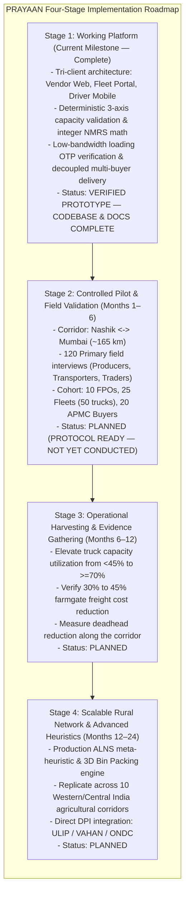

# 07. Implementation Roadmap & Milestones

> **Tech4Bharat 2026** — _Theme 5: Retail, FMCG & Logistics_  
> **Problem Statement 5.3**: Rural Freight  
> **Team**: Kernal500  
> **Last Updated**: November 2026

---

> [!IMPORTANT]
>
> ### ⏱️ 30-Second Executive TL;DR & Judge Fast-Track
>
> - **Execution Philosophy**: _"Validate locally. Measure rigorously. Scale responsibly."_ — Moving sequentially from an audited technical prototype to controlled single-corridor field trials, empirical data collection, and regional expansion.
> - **The 4 Implementation Stages**:
>   - **Stage 1 (Current)**: Verified working prototype with tri-client architecture, deterministic 3-axis capacity validation, integer NMRS cost splitting, and offline SQLite driver journal.
>   - **Stage 2 (Months 1–6)**: Controlled pilot on the high-density Nashik–Mumbai agricultural corridor (~165 km) with 10 FPOs, 25 fleet operators (50 trucks), and 20 APMC wholesale buyers.
>   - **Stage 3 (Months 6–12)**: Empirical evidence harvesting (elevate truck utilization from <45% to $`\ge 70\%`$, cut deadhead km by 30%).
>   - **Stage 4 (Months 12–24)**: Meta-heuristic optimization (ALNS), 3D bin packing, and expansion across 10 rural corridors.
> - **Judge Fast-Path (60 Seconds)**:
>   - Review the roadmap diagram in [**Section 1: Four-Stage Delivery Roadmap**](#1-guiding-execution-philosophy).
>   - Review pilot specifications and exit gates in [**Section 2: Stage Breakdown & Deliverables**](#2-stage-breakdown--deliverables) and [**Section 3: Milestones & Risk Gate Management**](#3-milestones--risk-gate-management).

---

## 1. Guiding Execution Philosophy

> _"Validate locally. Measure rigorously. Scale responsibly."_ — **Slide 7**

Rural freight in Bharat operates in an unforgiving physical environment characterized by unpaved feeder roads, intermittent cellular connectivity, extreme produce perishability, and tight operating margins. **PRAYAAN** follows a disciplined, staged execution methodology moving from an audited architectural prototype to controlled field trials, verified empirical data collection, and regional expansion.

---

## 2. Stage Breakdown & Deliverables

### Stage 1: Working Platform (Current Milestone — Complete)

- **Objective**: Deliver a fully auditable software platform demonstrating the complete commercial transaction, multi-attribute capacity validation, and verifiable physical custody lifecycle.
- **Core Technical Deliverables**:
  1. **Vendor Web Client**: Commodity listing management, AGMARKNET daily modal reference price display, and bilateral RFQ negotiation workflows.
  2. **Fleet Management Portal**: Vehicle compliance registry (RC, fitness, body type), corridor load discovery, 3-axis pooling planner, and driver dispatch.
  3. **Driver Mobile App**: Offline-tolerant execution, local SQLite transaction journal, 6-digit loading bay OTP handshake, load photo evidence capture, and stop-by-stop checklist.
  4. **Core Application API**: Non-floating-point financial calculations (integer paise), PostgreSQL Row-Level Security (RLS), and transactional event outbox.
- **Exit Milestone Gate**: Completed end-to-end multi-stop demonstration verifying that two independent shipments are physically validated, pooled, allocated freight proportionally down to the single paisa, and decoupled at delivery.

---

### Stage 2: Controlled Field Pilot & Field Validation

- **Objective**: Test the platform in live agricultural transport operations along a single arterial corridor and collect empirical baseline field data.
- **Target Corridor**: **Nashik District (Niphad, Yeola, Sinnar) $`\leftrightarrow`$ Mumbai Metropolitan Region (Vashi APMC, Kalyan Mandi)** (~165 km).
- **Participant Cohort**:
  - **10 Farmer Producer Organizations (FPOs)** representing approximately 1,500 member smallholder farmers.
  - **25 Regional Fleet Operators** representing 50 commercial vehicles (mix of SCVs, LCVs, and 10t ICVs).
  - **20 Wholesale APMC Buyers** operating out of Vashi Terminal Market.
- **Key Focus Areas**:
  - Execute the **120-interview field validation protocol** detailed in [`05_BUSINESS_MODEL_AND_UNIT_ECONOMICS.md`](05_BUSINESS_MODEL_AND_UNIT_ECONOMICS.md) to replace synthetic assumptions with primary empirical data.
  - Validate mobile client usability in low-literacy rural settings using Hindi and Marathi vernacular interfaces.
  - Test OTP and photo capture reliability in remote farmgate loading docks under spotty 2G/3G connectivity.
- **Exit Milestone Gate**: Successful execution of **100 live pooled commercial trips** with zero lost-custody disputes and verified farmer cost savings.

---

### Stage 3: Operational Hardening & Evidence Gathering

- **Objective**: Quantify real-world operational savings, verify asset utilization improvements, and harden software architecture against field telemetry.
- **Pilot Success Metrics & Verification Standards**:
  1. **Truck Capacity Utilization**: Elevate average payload and cubic volume utilization from the baseline of $`< 45\%`$ to $`\ge 70\%`$.
  2. **Measured Freight Cost Savings**: Validate a measurable $`30\%\text{ to }45\%`$ reduction in per-quintal freight expenses for participating FPO members compared to prevailing dedicated charter rates.
  3. **Empty Running Reduction**: Decrease return deadhead kilometers along the test corridor from $`40\%`$ to $`< 25\%`$ through backhaul matching.
  4. **Loading Bay Turnaround Time**: Reduce farmgate loading delays by $`\ge 40\%`$ through automated pre-arrival cargo readiness gates.
- **Exit Milestone Gate**: Publication of an audited pilot impact report signed by participating FPO leaders and transport union executives.

---

### Stage 4: Scalable Network & Advanced Optimization Layer

- **Objective**: Transition from deterministic corridor matching to dynamic, automated multi-stop optimization across regional transport grids.
- **Key Strategic Initiatives**:
  1. **ALNS & 3D Packing Deployment**: Production rollout of the Adaptive Large Neighborhood Search and 3D Bin Packing heuristics formalized in [`06_AI_ASSISTED_FREIGHT_POOLING_ROADMAP.md`](06_AI_ASSISTED_FREIGHT_POOLING_ROADMAP.md).
  2. **Corridor Grid Expansion**: Replicating the corridor model to 10 high-density rural agricultural corridors:
     - Kolhapur $`\leftrightarrow`$ Pune (Sugarcane, vegetables, jaggery)
     - Nagpur $`\leftrightarrow`$ Hyderabad (Oranges, cotton, pulses)
     - Indore $`\leftrightarrow`$ Ahmedabad (Soybean, wheat, spices)
     - Belagavi $`\leftrightarrow`$ Bengaluru (Vegetables, maize, commercial crops)
  3. **National Logistics Integration**: Establishing formal API interoperability with India's **Unified Logistics Interface Platform (ULIP)** for automated VAHAN vehicle fitness verification, and the **Open Network for Digital Commerce (ONDC)** for open buyer discovery.
- **Exit Milestone Gate**: A self-sustaining, multi-corridor freight pooling network supporting over 1,000 daily rural shipments with operating profitability.

---

## 3. Milestones & Risk Gate Management

| Milestone Gate                                                               |           Planned Target           | Primary Risk                                 | Embedded Mitigation                                                  |
| :--------------------------------------------------------------------------- | :--------------------------------: | :------------------------------------------- | :------------------------------------------------------------------- |
| **Gate 1: Prototype Code Freeze**                                            | Current Milestone (Tech4Bharat) | Architecture complexity & model error.       | Deterministic capacity validation & integer paise math.              |
| **Gate 2: Field Validation Audit** (120 Primary Interviews)               |              Month 3               | Low farmer digital trust & commingling fear. | Partner directly with established FPOs/KVKs & independent lot seals. |
| **Gate 3: Pilot 100-Trip Run** (Nashik $`\leftrightarrow`$ Mumbai Corridor) |              Month 6               | Loading dock delays & vehicle detention.     | 60-min wait timeout & detention compensation.                        |
| **Gate 4: Multi-Corridor Scaling** (10 Regional Arteries)                 |              Month 18              | Driver churn & commission broker pushback.   | Transparent ₹899 SaaS; zero transaction cuts.                        |
