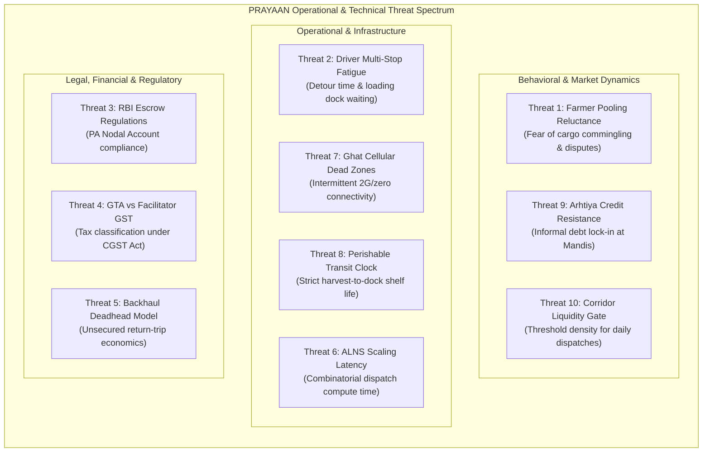

# Technical Limitations, System Threats & Hypothesis Validation

> **Critical Risk & Assumption Analysis for Competition Jury & Institutional Reviewers**  
> _PRAYAAN (Tech4Bharat 2026 / GAVS Hackathon, Theme 5: Rural Freight, Team Kernal500)_

---

## 1. Executive Summary

Every early-stage logistics innovation operating in Indian rural supply chains faces profound operational friction, regulatory complexity, and behavioral inertia. PRAYAAN does not present a frictionless fantasy. This document outlines the **Top 10 Technical and Operational Threats**, analyzes why each threat matters to system viability, details our current mitigation mechanisms, explicitly labels what remains an **UNVERIFIED HYPOTHESIS**, and defines our empirical validation protocols for Phase 1.

---

## 2. Comprehensive Analysis of the Top 10 Threats




---

### Threat 1: Willingness of Smallholder Farmers to Pool Produce
- **Statement of Risk**: Smallholder farmers may refuse to co-load produce with neighbors due to fears of cargo tampering, stolen crates, quality disputes, or harvesting time discrepancies.
- **Why It Matters**: Rural pooling fundamentally depends on multi-shipper consolidation. If farmers insist on single-farm charters, vehicle utilization collapses to baseline status quo (~27%).
- **Current Architectural Mitigation**:
  - Independent tamper-evident physical lot isolation (color-coded RF/barcode pallet seals).
  - Geofenced dual-OTP chain of custody (`schema.sql` lines 208–217) where farmer only releases cargo upon verified driver OTP.
  - Institutional aggregation through FPOs rather than unorganized individual farmers, utilizing the FPO dock as an aggregation nexus.
- **UNVERIFIED HYPOTHESIS**: We hypothesize that providing an authenticated digital chain of custody alongside an audited 40–50% freight reduction will overcome traditional co-loading reluctance among FPO member farmers.
- **Phase 1 Validation Protocol**: Conduct controlled 4-week trial across 5 FPOs in Niphad/Pimpalgaon (Nashik district). Measure opt-in rate vs. charter preference under identical price incentives.

---

### Threat 2: Driver Compliance with Multi-Stop Rural Corridors
- **Statement of Risk**: Independent truck drivers (SRTOs) accustomed to simple point-to-point full truckload (FTL) routes may refuse multi-stop routes (2–3 pickups, 2 drops) or demand exorbitant detention charges.
- **Why It Matters**: If drivers bypass scheduled collection points or exhibit excessive delay at intermediate farm gates, downstream delivery windows are violated.
- **Current Architectural Mitigation**:
  - Tight corridor spatial buffer: Waypoints are strictly constrained to $\le 10.0\text{ km}$ from the primary highway spine (NH-160), with detours capped at $\le 25\text{ min}$.
  - Financial incentives: PRAYAAN guarantees **higher net daily truck revenue** (₹12,000 pooled vs. ₹7,000 partial charter) plus a deterministic **50% fuel cash advance disbursed to driver account immediately upon origin pickup OTP**.
  - Dynamic turnaround timers: 30-minute dock loading window with automated compensation for shipper delays.
- **UNVERIFIED HYPOTHESIS**: Small commercial drivers will accept 2 intermediate collection stops if total daily trip earnings increase by $\ge 35\%$ and fuel advance is disbursed instantaneously.
- **Phase 1 Validation Protocol**: Onboard 25 owner-drivers on the Nashik–Mumbai route. Monitor stop adherence, GPS dwell times, and driver rating trends over 100 consecutive pooled trips.

---

### Threat 3: Payment Aggregator Escrow Regulations (RBI PA/PG Guidelines)
- **Statement of Risk**: Reserving shipper freight payments and distributing milestone payouts (50% origin, 50% delivery) could be classified as unauthorized deposit-taking or unlicensed nodal escrow operation under the RBI's *Guidelines on Regulation of Payment Aggregators and Payment Gateways (2020/2021)*.
- **Why It Matters**: Running an unapproved closed-loop wallet or private escrow account can lead to regulatory shutdowns and banking partner termination.
- **Current Architectural Mitigation**:
  - PRAYAAN strictly disclaims custody of user funds.
  - The platform operates solely as a technology instruction router integrating with licensed commercial Payment Aggregators (Razorpay Route / Cashfree Split Escrow / ICICI e-Collections).
  - Funds flow directly from buyer/shipper account into the PA's RBI-monitored Nodal/Escrow Account, and programmatic split transfers are triggered via webhooks upon authenticated OTP events.
- **UNVERIFIED HYPOTHESIS**: The planned split-milestone payout workflow falls cleanly within standard Payment Aggregator marketplace settlement rules without requiring an independent NBFC/P2P lending license.
- **Phase 1 Validation Protocol**: Commission formal review by a qualified Indian Banking & Financial Services Legal Practitioner prior to commercial mainnet transaction processing (logged in `HUMAN_TODO.md`).

---

### Threat 4: GST Liability on Freight Aggregation (GTA vs. Marketplace Facilitator)
- **Statement of Risk**: State tax authorities could classify PRAYAAN as a Goods Transport Agency (GTA) rather than a pure SaaS information marketplace, subjecting platform revenue or aggregate freight flows to 5% / 12% GST and consignment note liabilities.
- **Why It Matters**: If PRAYAAN is deemed a GTA, the platform becomes liable for consignment loss and tax compliance across billions of paise in gross freight, destroying unit economics.
- **Current Architectural Mitigation**:
  - Clean statutory segregation: Agricultural produce transport is exempt from GST under *CBIC Notification No. 12/2017-Central Tax (Rate)*.
  - PRAYAAN bills strictly a **SaaS Technology Platform Subscription (HSN/SAC 998431 / 998313)** at ₹899/month + 18% statutory GST (₹161.82).
  - The physical Consignment Note (Bilty) and transit carriage liabilities remain strictly between the shipper and the licensed Goods Transport Operator / Driver.
- **UNVERIFIED HYPOTHESIS**: Charging a flat SaaS subscription rather than a freight brokerage percentage legally isolates PRAYAAN from GTA carrier classification under Section 2(52) of the CGST Act.
- **Phase 1 Validation Protocol**: Obtain formal written tax opinion from an empanelled Chartered Accountant specializing in Indian logistics taxation (logged in `HUMAN_TODO.md`).

---

### Threat 5: Backhaul Deadhead Distance Assumptions
- **Statement of Risk**: While outbound agricultural freight from Nashik to Mumbai is heavy, the return corridor (Mumbai to Nashik) consists primarily of industrial, FMCG, and agricultural input loads. If return loads are unavailable, trucks must return empty, inflating effective costs.
- **Why It Matters**: Our benchmark assumes a backhaul deadhead rate of 24% for Stage 1 and 18% for Stage 4 (vs. 40% status quo). If return utilization is zero, baseline costs rise by up to 25%.
- **Current Architectural Mitigation**:
  - The benchmark suite exposes backhaul rates as transparent, parameterized command-line arguments (`--empty-rate-m4 0.24`, etc.) and labels them clearly as assumptions in all outputs.
  - Bi-directional corridor pairing: PRAYAAN actively aggregates outbound return cargo (fertilizer bags from Rasayani/Taloja, empty plastic produce crates, retail FMCG supplies) back to rural distribution nodes.
- **UNVERIFIED HYPOTHESIS**: Urban distribution centers in Bhiwandi/Thane have sufficient daily dry freight returning to Nashik farming clusters to achieve a $\le 24\%$ empty deadhead rate.
- **Phase 1 Validation Protocol**: Audit 60 days of reverse-corridor shipping demand in the Bhiwandi warehousing cluster to quantify actual available backhaul cargo volume.

---

### Threat 6: ALNS Metaheuristic Scaling Latency under Dense Geographies
- **Statement of Risk**: In our benchmark of 50 consignments, Stage 4 ALNS solves within ~56 ms. However, under high-density statewide scaling (e.g., 2,500 requests across 15 interconnected corridors), metaheuristic neighborhood exploration times could scale super-linearly, causing dispatch delays.
- **Why It Matters**: Dispatch decisions must be computed rapidly during late-afternoon harvest windows (4:00 PM – 6:30 PM) to ensure vehicles depart before night market deadlines.
- **Current Architectural Mitigation**:
  - **Stage 1 Fallback Guarantee**: The deterministic engine runs in **0.2 milliseconds** ($O(n \log n)$), ensuring immediate dispatch viability regardless of ALNS status.
  - Corridor sharding: The optimization problem is decomposed by geographic highway corridors (e.g., Nashik–Mumbai, Pune–Mumbai, Solapur–Pune), keeping per-instance batch sizes under 150 consignments.
  - Any-time termination: ALNS uses a strict computational time budget (e.g., 5.0 seconds maximum) and returns the best incumbent solution found.
- **UNVERIFIED HYPOTHESIS**: Corridor-based spatial partitioning limits ALNS problem complexity such that solve times remain $< 2.0\text{ seconds}$ for 99% of daily commercial instances.
- **Phase 1 Validation Protocol**: Execute synthetic stress tests simulating 500 consignments per corridor across 10 parallel worker threads and measure memory footprint and convergence wall-clock times.

---

### Threat 7: Cellular Dead Zones on Rural Ghat Roads (Kasara Ghat Connectivity)
- **Statement of Risk**: The primary transit route between Nashik and Mumbai traverses the Sahyadri mountain range (Kasara / Thal Ghat), where deep valleys experience frequent cellular network dropouts (zero 4G/5G data coverage for 15–25 km stretches).
- **Why It Matters**: Real-time GPS pings, cloud API calls, and instant custody event submissions will fail if the application requires continuous internet connectivity.
- **Current Architectural Mitigation**:
  - **Local-First Offline State Machine**: The Driver Mobile App utilizes local SQLite storage with cryptographic timestamping.
  - Event Queueing: Custody events and GPS coordinates are stored locally with monotonic sequence IDs and cryptographically signed hashes.
  - Automatic Reconciliation: Upon detecting cellular re-connection at the base of the ghat (e.g., Kalyan/Asangaon), the driver client batch-syncs queued events using idempotent payloads (`idempotency_key UUID` in `schema.sql`).
- **UNVERIFIED HYPOTHESIS**: Offline cryptographic event logging is legally and operationally sufficient to prevent driver dispute manipulation during mountain transit dead zones.
- **Phase 1 Validation Protocol**: Conduct physical test drive across NH-160 Kasara Ghat with test devices on Jio and Airtel networks, recording exact latency and packet loss profiles.

---

### Threat 8: Perishable Produce Quality Degradation (Shelf-Life Clock)
- **Statement of Risk**: Highly perishable horticulture (tomatoes, strawberries, leafy greens) has a severe post-harvest respiration rate. Introducing 2–3 intermediate pickup stops could delay transit by 45–90 minutes, accelerating thermal spoilage in ambient (non-reefer) trucks.
- **Why It Matters**: A 50% savings on freight is worthless if produce value drops by 20% due to heat-induced wilting or physical bruising during multi-stop handling.
- **Current Architectural Mitigation**:
  - Commodity-specific transit gates: Perishables are tagged with maximum allowable transit duration ($\Delta t_{\text{max}}$). If a proposed pool route exceeds this duration, the consignment is rejected by Stage 1 dispatch.
  - Cross-compatibility schema: `schema.sql` enforces compatibility checks for ethylene emissions (`ethylene_profile`), pungent odors (`is_odor_pungent`), and moisture sensitivity (`is_moisture_sensitive`).
  - Strict tarpaulin and ventilation requirements enforced in vehicle profile checks.
- **UNVERIFIED HYPOTHESIS**: Limiting total detour time to $\le 45\text{ minutes}$ for ambient-temperature vegetable transit maintains commercial produce grade at Mumbai APMC arrival without measurable price markdown.
- **Phase 1 Validation Protocol**: Partner with Maharashtra State Agricultural Marketing Board (MSAMB) or an agricultural university (MPKV Rahuri) to benchmark Brix and firmness loss across 20 pooled test runs.

---

### Threat 9: APMC Commission Agent (Arhatiya) Credit Resistance
- **Statement of Risk**: Traditional *arhatiyas* (commission agents) at APMC mandis provide informal production credit and harvest advances to small farmers. In return, farmers are informally bound to send their produce via the arhatiya's preferred transporter.
- **Why It Matters**: Even if PRAYAAN is cheaper, farmers trapped in debt-interlinked marketing contracts cannot freely choose their freight carrier without risking loan recall.
- **Current Architectural Mitigation**:
  - **Cooperative Channel Strategy**: PRAYAAN focuses on **FPOs (Farmer Producer Organisations)** and progressive grower collectives who possess institutional autonomy and aggregate volume outside single-agent credit traps.
  - Buyer-Side Direct Integration: Enabling bulk wholesale institutional buyers (e.g., Reliance Retail, BigBasket, Mother Dairy) to purchase directly from FPOs and sponsor inbound freight subscriptions.
  - Non-confrontational positioning: PRAYAAN operates strictly as a transport logistics utility, not a disintermediating produce trader.
- **UNVERIFIED HYPOTHESIS**: FPO-aggregated farmers possess sufficient market autonomy to allocate freight independently of mandi commission agent credit dictates.
- **Phase 1 Validation Protocol**: Survey financial structures across 10 target FPOs in Nashik district to establish the percentage of member produce bound by informal trader advances.

---

### Threat 10: Minimum Corridor Liquidity Threshold (Cold-Start Problem)
- **Statement of Risk**: Pooling requires matching: there must be sufficient cargo moving along the same corridor in the same 4-hour window to fill trucks. In a low-density corridor with only 2–3 requests per day, pooling fails, leaving trucks empty or shipments delayed.
- **Why It Matters**: Without liquidity, either vehicles depart under-utilized (violating the 70% target) or shipments are delayed past market opening hours, creating negative user feedback loops.
- **Current Architectural Mitigation**:
  - **High-Density Anchor Corridor Selection**: PRAYAAN launches exclusively on high-volume lanes (Nashik–Mumbai NH-160, where $> 4,500\text{ tonnes}$ of vegetables move daily).
  - Minimum Daily Liquidity Gate: Corridor activation requires minimum commitments of $\ge 30\text{ tonnes/day}$ ($\ge 4\text{ FPOs}$) before algorithmic pooling is enabled.
  - Transparent Unpooled Fallback: When pooled routes cannot be formed within 90 minutes of the cutoff window, the platform immediately alerts the shipper and defaults to standard dedicated vehicle booking.
- **UNVERIFIED HYPOTHESIS**: Confining operations to 1 high-density corridor (Nashik–Mumbai) during Year 1 ensures sufficient daily shipment density ($> 30\text{ requests/day}$) to sustain $\ge 70\%$ truck utilization.
- **Phase 1 Validation Protocol**: Maintain a digital consignment reservation book across partner FPOs during the 60-day pre-launch window to verify unassisted daily density.

---

## 3. Summary of Risk Governance

| Threat # | Description | Primary Vulnerability | Status | Phase 1 Verification Pathway |
| :---: | :--- | :--- | :--- | :--- |
| **1** | Farmer Pooling Willingness | Cargo trust & co-loading fear | `UNVERIFIED HYPOTHESIS` | 4-week FPO trial in Niphad; measure opt-in rate vs. charter |
| **2** | Driver Multi-Stop Compliance | Rural detour reluctance | `UNVERIFIED HYPOTHESIS` | 100-trip pilot on NH-160; monitor stop dwell time & rating |
| **3** | Payment Aggregator Escrow | RBI nodal account regulations | `UNVERIFIED HYPOTHESIS` | Legal review by Banking/Fintech Counsel (`HUMAN_TODO.md`) |
| **4** | GTA vs. Facilitator GST | 5%/12% transport GST liability | `UNVERIFIED HYPOTHESIS` | Formal tax opinion from CA (`HUMAN_TODO.md`) |
| **5** | Return Deadhead Model | Return-leg cargo availability | `UNVERIFIED HYPOTHESIS` | 60-day reverse freight audit in Bhiwandi hub |
| **6** | ALNS Scaling Latency | Solve time under 1,000+ nodes | `UNVERIFIED HYPOTHESIS` | Parallelized multi-thread stress benchmark |
| **7** | Ghat Cellular Dead Zones | Offline transaction loss | `UNVERIFIED HYPOTHESIS` | Field drive with SQLite monotonic audit logging |
| **8** | Produce Shelf-Life Decay | Heat buildup during detours | `UNVERIFIED HYPOTHESIS` | Produce firmness & respiration trial with MPKV Rahuri |
| **9** | Arhatiya Credit Resistance | Informal debt lock-in | `UNVERIFIED HYPOTHESIS` | FPO debt-structure audit across 10 Nashik cooperatives |
| **10** | Minimum Liquidity Gate | Cold-start matching failure | `UNVERIFIED HYPOTHESIS` | Pre-launch reservation book verification ($> 30\text{ t/day}$) |

---

*This document is maintained as part of the official PRAYAAN technical dossier. All listed hypotheses will be systematically evaluated, and outcomes will be recorded in subsequent technical revisions.*
```
